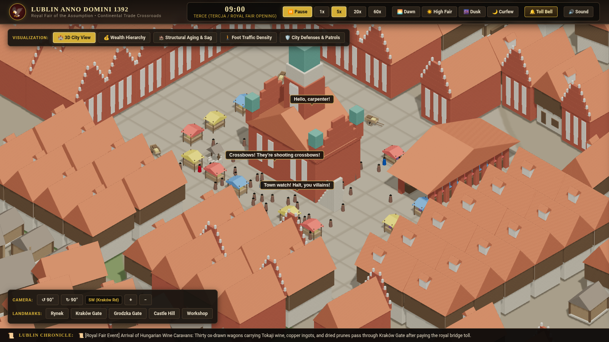
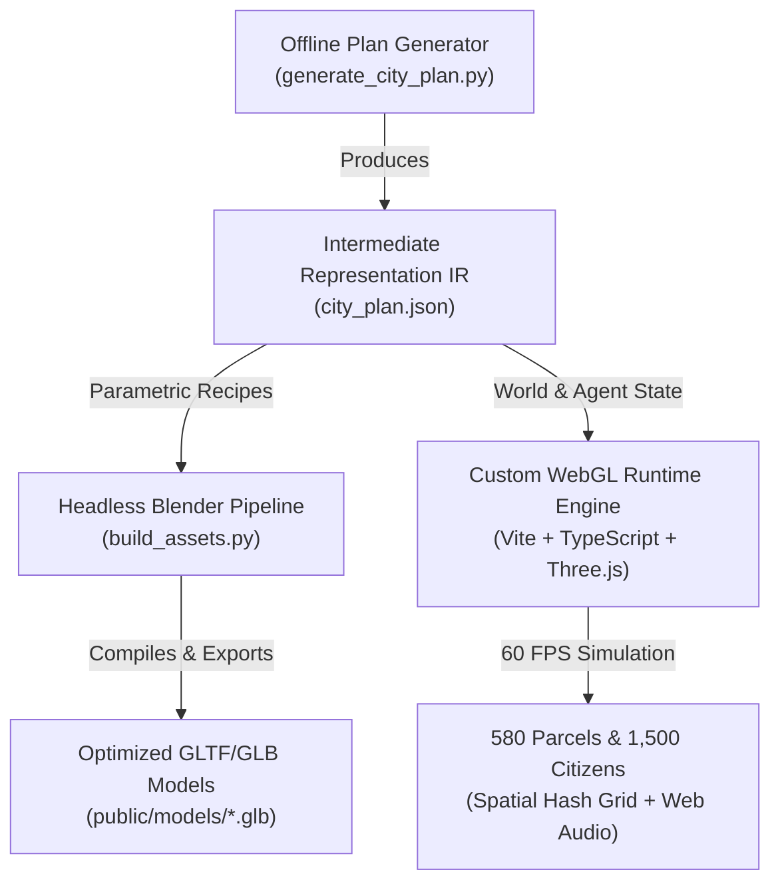

# Lublin Anno Domini 1392: Medieval Isometric City Simulation

[](https://vitejs.dev/)
[](https://www.typescriptlang.org/)
[](https://threejs.org/)
[](https://www.blender.org/)
[](LICENSE)

An authentic, data-driven medieval city simulation and procedural 3D asset pipeline set in **Lublin around 1392** during its historic **Royal Fair**, granted under the charter of **King Władysław II Jagiełło**.



---

## Key Features

- **True Isometric 3D Projection**: Fixed dimetric / isometric perspective ($35.264^\circ$ pitch) with smooth 4-quadrant $90^\circ$ view rotations (SW, NW, NE, SE).
- **Directional PCF Soft Shadows**: Diagonal sunlight casting soft real-time contact shadows onto cobblestone plazas and building facades.
- **Headless Blender Procedural Pipeline**: CLI automation script ([`build_assets.py`](build_assets.py)) compiling parametric recipes into 16 optimized low-poly `.glb` models (civic landmarks, Gothic church, castle donjon, houses, outbuildings, stalls, carts, well, curtain defense).
- **Separating Axis Theorem (SAT) Zero-Overlap Urban Morphology**: 580 parcels generated using historical Magdeburg Law burgage ribbon planning and 2D Oriented Bounding Box collision verification—guaranteeing mathematically zero overlapping roofs or intersecting facades.
- **Living Autonomous Simulation**: 1,500 persistent citizens across 580 parcels with unique names, 18 craft guilds, wealth hierarchies, and schedules keyed to 8 canonical church bell hours.
- **Interactive Speech Bubbles & Prompts**: In-world speech bubbles (`"Hello, carpenter!"`, `"Crossbows! They're shooting crossbows!"`) and contextual hover interaction prompts (`[E] Stach z Ponikwody, visitor to the fair`).
- **Procedural Church Bell Synthesizer**: Web Audio API physical acoustic modeling using additive synthesis across 7 inharmonic partials with metallic decay.
- **Historical Topographical Accuracy**: Loess spur promontory (~8.84 ha) bounded by the Czechówka and Bystrzyca valleys, enclosed by curtain walls with 14 defensive towers and 2 main gates.

---

## Architecture & Data Flow



---

## Urban Morphology: Lublin 1392

1. **Civic Core (Rynek)**:
   - **Old Town Hall (*Ratusz*)**: Polish Gothic brick building with white plaster blind-arcades (*blendówki*), high clock tower, 4 corner turrets with verdigris copper spires, stepped crow-stepped gables, and external stone stairs.
   - **Szmatruz (Royal Cloth & Bread Hall)**: 22 brick pillars with limestone capitals, central covered aisle, and vendor stalls.
   - **Royal Fair Stalls & Carts**: Colorful striped awnings (red/white, blue/white, yellow/white), wooden trestle tables loaded with cheese, bread, textiles, and spoked-wheel market carts.
   - **Municipal Well & Pillory**: Cylindrical stone wellhead with timber shingle roof and iron windlass.
2. **Defensive Perimeter**:
   - Curtain wall with battlements, inner wooden wall-walk galleries, and 14 guild defense towers.
   - **Kraków Gate (*Brama Krakowska*)**: Southwestern gateway with octagonal brick tower and barbican drawbridge.
   - **Grodzka Gate (*Brama Grodzka*)**: Northeastern gateway leading to the bridge over the Czechówka ravine.
3. **Castle Hill (*Wzgórze Zamkowe*)**:
   - Romanesque cylindrical limestone **Donjon Keep** (30m high, 3m thick walls).
   - Gothic **Royal Holy Trinity Chapel** with Ruthenian-Byzantine fresco motifs.
   - Royal Palace Hall (*Dwór Królewski*).
4. **Parcellation & Streets**:
   - 580 plots across 7 districts with guaranteed non-repeating building archetypes along street fronts.
   - Authentic house types: interlocking timber log cabins (*domy zrębowe*), half-timbered jettied tenements (*kamienice szachulcowe*), and stepped brick patrician mansions.

---

## Quickstart

### Prerequisites
- [Node.js](https://nodejs.org/) (v20+ recommended)
- [Python 3](https://www.python.org/) (v3.10+)
- [Blender](https://www.blender.org/) (v3.6 LTS+ for procedural 3D model generation)

### Installation
```bash
# Clone the repository
git clone https://github.com/erlfas/isometric-city.git
cd isometric-city

# Install frontend dependencies
npm install
```

### Running the Development Server
```bash
npm run dev
```
Open [http://localhost:5173](http://localhost:5173) in your browser.

### Building for Production
```bash
npm run build
npm run preview
```

---

## Procedural Asset Pipeline (Blender CLI)

To procedurally compile all 13 low-poly GLB models from source recipes:

```bash
# Using local or portable Blender installation:
blender --background --python build_assets.py
```

The script automatically generates and saves the models into `public/models/`:
- `town_hall.glb`
- `szmatruz.glb`
- `market_stall_red_white.glb`, `market_stall_blue_white.glb`, `market_stall_yellow_white.glb`
- `market_cart.glb`
- `town_well.glb`
- `house_timber_log.glb`
- `house_half_timber.glb`
- `house_patrician_brick.glb`
- `curtain_wall.glb`
- `curtain_tower.glb`
- `tree_oak.glb`

---

## Controls & Keyboard Shortcuts

| Input | Action |
|---|---|
| **Mouse Drag / Left Click Drag** | Pan isometric camera across the city |
| **Mouse Wheel** | Zoom in / Zoom out smoothly |
| **Q / E** | Rotate camera $90^\circ$ counter-clockwise / clockwise |
| **W, A, S, D / Arrow Keys** | Pan camera |
| **Spacebar** | Toggle simulation pause / resume |
| **1, 2, 3, 4** | Set simulation speed ($1\times, 5\times, 20\times, 60\times$) |
| **Hover on Citizen** | Inspect character name and status pill (`[E]`) |
| **Click on Citizen** | Open Citizen Dossier, wallet, and 24h schedule timeline |
| **Click on Building** | Open Parcel Registry, architecture archetype, and residents list |

---

## Documentation & Specialized Skills

- [`KEY_FINDINGS.md`](KEY_FINDINGS.md): Detailed post-mortem report covering WebGL face culling pitfalls, shadow bias configuration, and Blender material RNA retention.
- [`ARCHITECTURE.md`](ARCHITECTURE.md): Comprehensive system specification and Lublin 1392 urban morphology.
- [`skills/blender-procedural-asset-pipeline/SKILL.md`](skills/blender-procedural-asset-pipeline/SKILL.md): Headless Blender procedural 3D authoring guide.
- [`skills/webgl-isometric-simulation-testing/SKILL.md`](skills/webgl-isometric-simulation-testing/SKILL.md): Automated headless Chromium visual test harness.

---

## License

This project is licensed under the [MIT License](LICENSE).
