# Visual Asset Gallery & AI Image Generation Prompts
## Lublin Anno Domini 1392 — 2D Concept Art & 3D Modeling Reference Archive

**Artistic Direction:** Late-1990s / Early-2000s Pre-Rendered Isometric PC Strategy Game (*Stronghold*, *Knights and Merchants*, *Patrician III*, *The Guild / Europa 1400*)  
**Projection Standard:** True Orthographic (Dimetric $30^\circ$ pitch / True Isometric $35.264^\circ$, $45^\circ$ base yaw, zero perspective convergence)  
**Palette Standard:** Earthy, weathered materials (Backsteingotik red brick `#8C3B2B`, aged oak framing `#4A3B2C`, sun-bleached thatch `#9E8656`, loess limestone `#B8B09E`, oxidized copper `#3D7A68`, olive grasslands `#556236`, dry mud roads `#7A6A53`).

---

## Table of Contents
1. [Master Prompt Engineering Standards](#1-master-prompt-engineering-standards)
2. [Artisan Guild Workshop Multi-View Reference Photos](#2-artisan-guild-workshop-multi-view-reference-photos-reference_photos)
   - [Baker's House & Masonry Oven (3-View Set)](#bakers-house--masonry-oven-3-view-set)
   - [Tanner's Riverside Workshop](#tanners-riverside-workshop)
   - [Brewer's Malthouse & Cask Yard](#brewers-malthouse--cask-yard)
   - [Blacksmith's Workshop & Open Forge (3-View Set)](#blacksmiths-workshop--open-forge-3-view-set)
   - [Potter's Shed & Kiln Yard](#potters-shed--kiln-yard)
   - [Weaver's Half-Timber Workshop](#weavers-half-timber-workshop)
   - [Riverside Watermill](#riverside-watermill)
3. [Worker & Citizen 3-View Turnaround Sheets](#3-worker--citizen-3-view-turnaround-sheets-reference_photosworkers)
   - [Master Blacksmith Turnaround](#master-blacksmith-turnaround)
   - [Artisan Baker Turnaround](#artisan-baker-turnaround)
   - [Master Tanner Turnaround](#master-tanner-turnaround)
   - [Master Carpenter & Joiner Turnaround](#master-carpenter--joiner-turnaround)
   - [Master Brewer & Cooper Turnaround](#master-brewer--cooper-turnaround)
   - [Master Potter Turnaround](#master-potter-turnaround)
   - [Master Weaver Turnaround](#master-weaver-turnaround)
   - [City Halberdier & Gate Guard Turnaround](#city-halberdier--gate-guard-turnaround)
   - [Dominican Friar Herb Gardener Turnaround](#dominican-friar-herb-gardener-turnaround)
   - [Peasant Farmer & Scyther Turnaround](#peasant-farmer--scyther-turnaround)
   - [Master Stonemason Turnaround](#master-stonemason-turnaround)
   - [Patrician Merchant & Councilman Turnaround](#patrician-merchant--councilman-turnaround)
   - [Burgher Townswoman & Market Trader Turnaround](#burgher-townswoman--market-trader-turnaround)
   - [Forest Woodcutter Turnaround](#forest-woodcutter-turnaround)
4. [Macro City District & Regional Concept Art](#4-macro-city-district--regional-concept-art-concept_art)
   - [Artisan and Brewery District](#artisan-and-brewery-district)
   - [Brick Monastery with a Cloister Garden](#brick-monastery-with-a-cloister-garden)
   - [Fortified Castle Courtyard & Bailey](#fortified-castle-courtyard--bailey)
   - [Fortified River Crossing with Watermill](#fortified-river-crossing-with-watermill)
   - [Hillside Iron Mine & Smelting Camp](#hillside-iron-mine--smelting-camp)
   - [Riverside Harbor Wharves](#riverside-harbor-wharves)
   - [Rural Farming Village & Post Windmill](#rural-farming-village--post-windmill)
   - [Stone Quarry & Logging Camp](#stone-quarry--logging-camp)
   - [Tournament Fairground Outside City Walls](#tournament-fairground-outside-city-walls)
5. [In-Engine Screenshots & Visual Deliverables](#5-in-engine-screenshots--visual-deliverables)
6. [Summary Matrix: Image to 3D Model Mapping](#6-summary-matrix-image-to-3d-model-mapping)

---

## 1. Master Prompt Engineering Standards

All reference images and concept art are generated using a disciplined prompt structure ensuring visual continuity across workshops and districts:

```
[CAMERA & ENGINE AESTHETIC]
"2D isometric medieval city-builder game screenshot, late 1990s PC strategy game aesthetic, pre-rendered 3D sprites,"

[SUBJECT & WORKSPACE DETAILS]
"[SPECIFIC BUILDING TYPE/WORKSHOP], [PRIMARY EXTERIOR MACHINERY & WORKSPACE], [OUTDOOR EQUIPMENT & PROPS],"

[ARCHITECTURAL STYLE & GEOGRAPHY]
"Central European Brick Gothic and timber vernacular architecture, [ROOF & WALL MATERIALS],"

[PALETTE, LIGHTING & PROJECTION CONSTRAINTS]
"muted earthy color palette, crisp surface textures, hard directional drop shadows, orthographic projection, no UI"
```

---

## 2. Artisan Guild Workshop Reference Photos (`reference_photos/`)

These images provide direct visual blueprints for procedural Blender modeling (`build_assets.py`) and master catalog descriptions (`BUILDINGS_AND_WORKERS_CATALOG.md`).

---

### Baker's House & Masonry Oven (3-View Set)

#### Front / Primary Street Entrance:
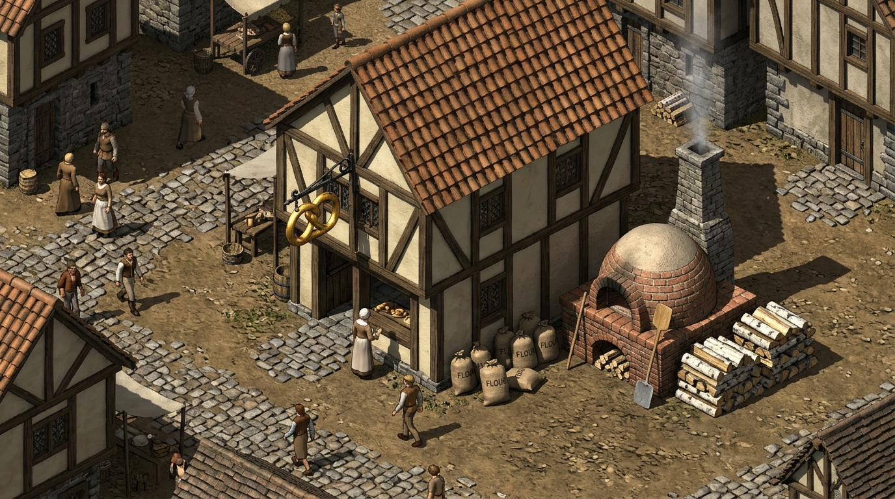

#### Side Profile Elevation (Flour Chute & Firewood Shed):
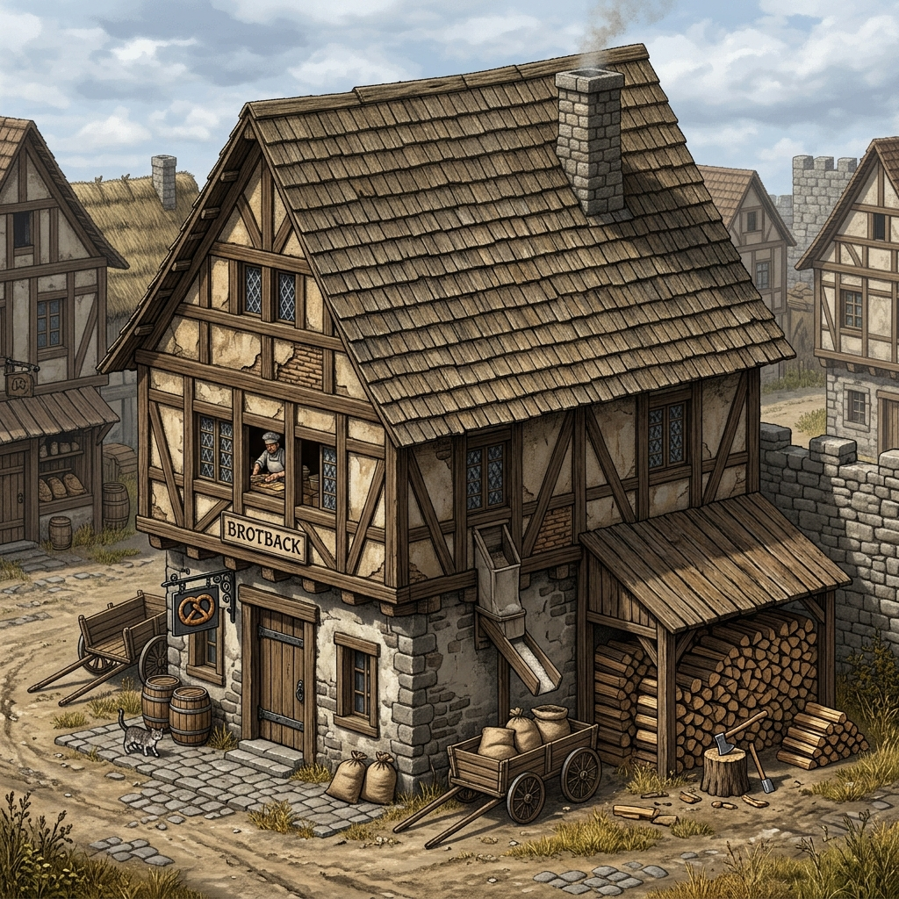

#### Rear Yard Elevation (Domed Stone Bake-Oven & Ash Shovels):
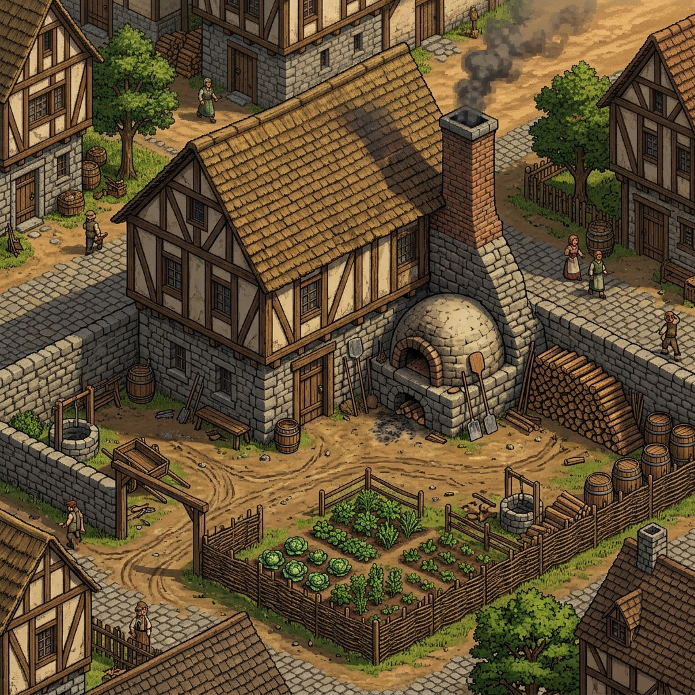

- **Directory:** [`reference_photos/baker_house/`](../reference_photos/baker_house/)
  - `front.jpg`: Isometric front facade with pretzel guild sign and entrance portal.
  - `side.jpg`: Side profile showing steep $50^\circ$ roof, side firewood shelter, and flour chute.
  - `back.jpg`: Rear yard with massive domed stone bread oven, brick chimney, bread peel, and firewood cords.
- **Associated 3D Model:** [`public/models/baker_house.glb`](../public/models/baker_house.glb)
- **Associated Worker:** `worker_baker` ([Turnaround Reference](#artisan-baker-turnaround))
- **Key Generation Prompts:**
  - *Front View (16:9):*
    ```text
    2D isometric medieval city-builder game screenshot, late 1990s PC strategy game aesthetic, pre-rendered 3D sprites, medieval baker's house and bakery workshop, outdoor domed brick bread oven with smoking stone chimney, stacked birch firewood cords, wooden peel shovel, sacks of flour, gilded pretzel guild sign, timber-framed plaster walls, clay pantile roof, muted earthy color palette, crisp surface textures, hard directional drop shadows, orthographic projection, no UI
    ```
  - *Side Profile View — Harmonized (1:1):*
    ```text
    2D isometric medieval city-builder game screenshot, late 1990s PC strategy game aesthetic, pre-rendered 3D sprites, side profile view of medieval baker's house, steep 50-degree gable roof with red terracotta clay pantiles matching front facade, half-timbered upper floor with cream plaster and dark oak beams, limestone ashlar base, outdoor domed red-brick bread baking oven with tall smoking stone chimney projecting on the flank, protective timber lean-to canopy over oven, stacked birch firewood logs, flour delivery chute, Central European Brick Gothic, muted earthy palette, hard directional drop shadows, orthographic projection, no UI
    ```
  - *Rear Yard View (1:1):*
    ```text
    2D isometric medieval city-builder game screenshot, late 1990s PC strategy game aesthetic, rear yard view of medieval baker house, large domed stone bread baking oven with smoking brick chimney built into the back wall, wooden ash shovels, bread peel leaning against oven, stacked cords of firewood, flour barrels, small vegetable garden, wattle fence, Central European timber and stone architecture, muted earthy palette, hard directional drop shadows, orthographic projection, no UI
    ```
> [!NOTE]
> **Architectural Consistency Judge (ACJ) Audit: Remediated & Harmonized**  
> The initial side profile generation displayed grey cedar wood shingles and an isolated firewood shed. The Judge rejected this due to material and machinery discontinuity with `front.jpg`. A targeted remediation was generated anchoring the red terracotta clay pantile roof, cream half-timbering, limestone ashlar plinth, and the domed brick baking oven complex with its tall smoking chimney on the right flank under a protective lean-to canopy. All features now align 100% with `baker_house.glb` in Blender.

---

### Tanner's Riverside Workshop

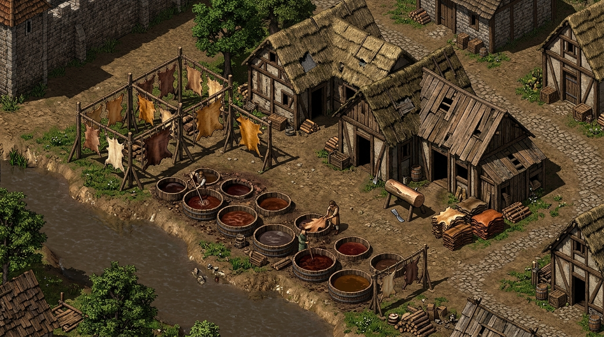

- **File Path:** [`reference_photos/tanner_workshop.jpg`](../reference_photos/tanner_workshop.jpg)
- **Associated 3D Model:** [`public/models/house_tanner.glb`](../public/models/house_tanner.glb)
- **Associated Worker:** `worker_master_tanner`
- **Aspect Ratio:** `16:9`
- **Generation Prompt:**
  ```text
  2D isometric medieval city-builder game screenshot, late 1990s PC strategy game aesthetic, pre-rendered 3D sprites, medieval tanner's workshop along riverbank, outdoor wooden hide soaking vats with dark tannin liquid, large wooden drying racks with stretched animal skins and hides, fleshing beam with scraping knife, stacks of pelts, rustic timber and thatch workshop building, muted earthy color palette, crisp surface textures, hard directional drop shadows, orthographic projection, no UI
  ```
- **Architectural & Workspace Key Features:**
  - Rustic weathered log cabin with open-sided upper slatted drying gallery for river breeze circulation.
  - Sagging straw thatch roof with mossy eaves.
  - 4 sunken rectangular wooden tanning vats dug into the riverbank ground, filled with dark brown oak-bark tannin liquor.
  - 2 tall timber vertical trestle frames holding stretched rawhide pelts.
  - Low tilted wooden fleshing beam (*stół kuśnierski*) with two-handled curved scraping drawknife.
  - Piles of salted raw pelts and finished cured leather hides.
  - Hanging tavern guild sign: stretched ox hide.

---

### Brewer's Malthouse & Cask Yard

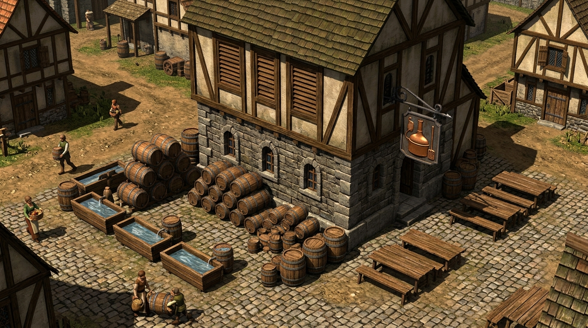

- **File Path:** [`reference_photos/brewer_malthouse.jpg`](../reference_photos/brewer_malthouse.jpg)
- **Associated 3D Model:** [`public/models/house_brewer.glb`](../public/models/house_brewer.glb)
- **Associated Workers:** `worker_master_brewer`, `worker_cooper`
- **Aspect Ratio:** `16:9`
- **Generation Prompt:**
  ```text
  2D isometric medieval city-builder game screenshot, late 1990s PC strategy game aesthetic, pre-rendered 3D sprites, medieval brewer malthouse and tavern brewery, sturdy stone plinth with half-timbered upper floor with wooden ventilation louvers, copper brew kettle mash paddle guild sign, outdoor yard filled with wooden beer casks and barrels stacked in pyramids, soaking wash troughs, outdoor wooden tavern bench, warm earthy tones, crisp surface textures, hard directional drop shadows, orthographic projection, no UI
  ```
- **Architectural & Workspace Key Features:**
  - Massive Gothic brick ground floor with arched wagon portal.
  - Half-timbered upper story fitted with horizontal wooden louvers (*żaluzje słodowe*) for venting grain moisture during barley malting.
  - Weathered oak wooden shingle roof.
  - Cask-washing yard with 2 long wooden water-soak troughs with stone drainage.
  - Pyramid stack of 6 oak beer casks bound with iron hoops.
  - Outdoor tavern hospitality area with 2 heavy oak trestle tables and drinking benches.
  - Hanging guild sign: polished copper mash paddle and tankard.

---

### Blacksmith's Workshop & Open Forge (3-View Set)

#### Front / Primary Forge Canopy:
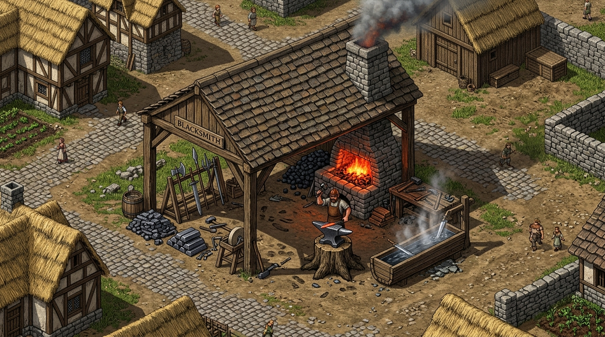

#### Side Profile Elevation (Coal Storage Bunker & Quench Trough):
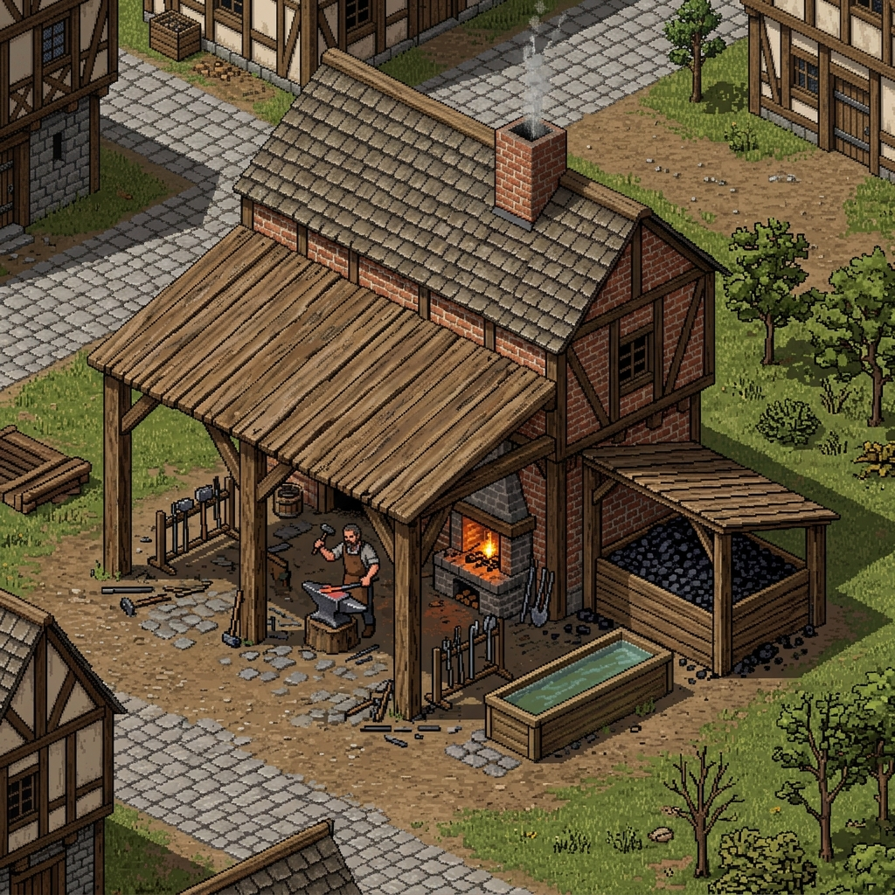

#### Rear Storage Yard (Bloomery Smelting Furnace & Iron Racks):
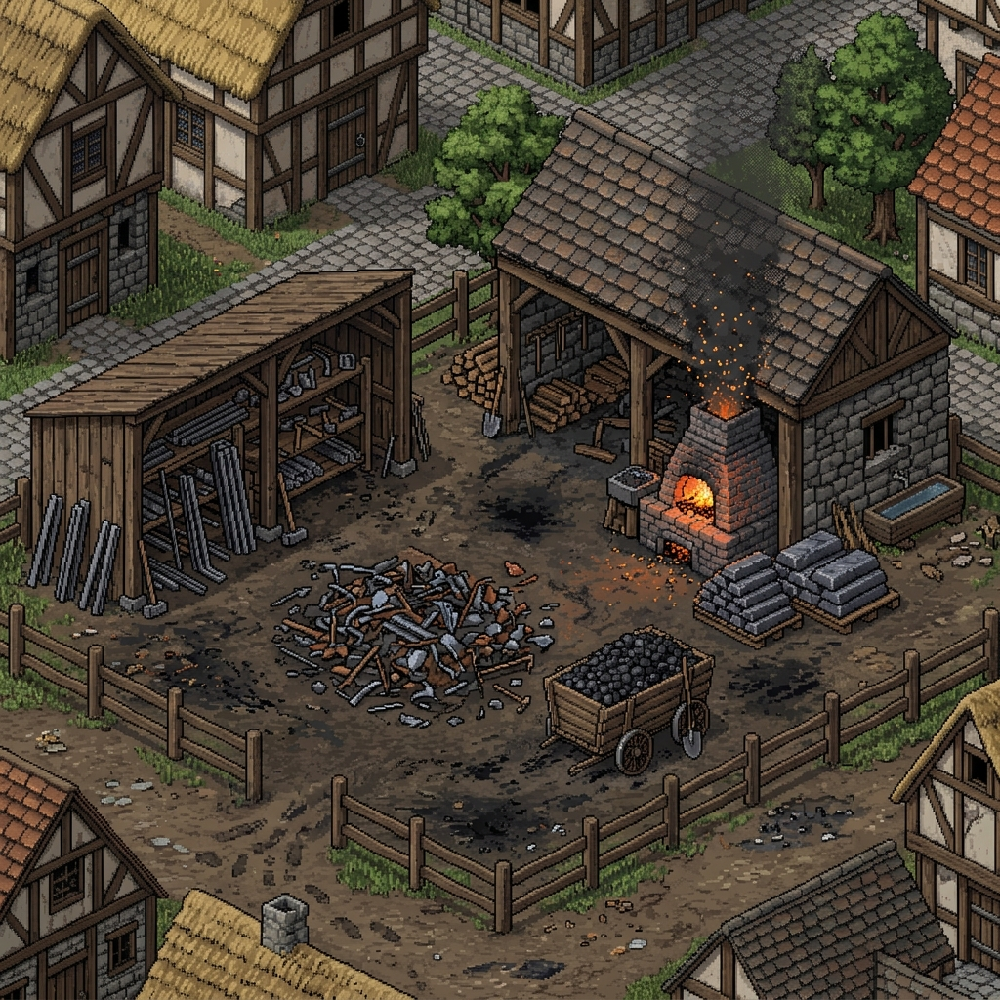

- **Directory:** [`reference_photos/blacksmith_workshop/`](../reference_photos/blacksmith_workshop/)
  - `front.jpg`: Primary open forge with anvil, glowing hearth, weapon rack, and timber canopy.
  - `side.jpg`: Side profile showing coal and charcoal storage shed, water trough, and brick chimney stack.
  - `back.jpg`: Rear storage yard with brick bloomery furnace, raw iron billets, scrap metal pile, and slag.
- **Associated 3D Model:** [`public/models/blacksmith_workshop.glb`](../public/models/blacksmith_workshop.glb)
- **Associated Workers:** `worker_blacksmith` ([Turnaround Reference](#master-blacksmith-turnaround))
- **Key Generation Prompts:**
  - *Front View (16:9):*
    ```text
    2D isometric medieval city-builder game screenshot, late 1990s PC strategy game aesthetic, pre-rendered 3D sprites, medieval blacksmith workshop, outdoor covered timber shed with open masonry hearth forge and glowing hot orange embers, thick smoke from stone chimney, heavy iron anvil on oak tree stump, water quenching wooden trough with rising steam, weapon rack with iron axe heads and swords, stacks of coal and iron ingots, muted earthy color palette, crisp surface textures, hard directional drop shadows, orthographic projection, no UI
    ```
  - *Side Profile View (1:1):*
    ```text
    2D isometric medieval city-builder game screenshot, late 1990s PC strategy game aesthetic, side profile elevation view of medieval blacksmith forge, timber lean-to canopy supported by heavy oak posts, covered coal and charcoal storage bin with dark coal heap, water quench trough, iron tool racks, Central European brick and timber vernacular, hard directional drop shadows, orthographic projection, no UI
    ```
  - *Rear Yard View (1:1):*
    ```text
    2D isometric medieval city-builder game screenshot, late 1990s PC strategy game aesthetic, rear storage yard view of medieval blacksmith forge, brick bloomery smelting furnace with glowing smoke, stacked pig iron ingots, racks of raw iron bars, scrap metal scrapheap, coal cart, low timber fence, dirt ground with soot patches, orthographic projection, no UI
    ```

---

### Potter's Shed & Kiln Yard

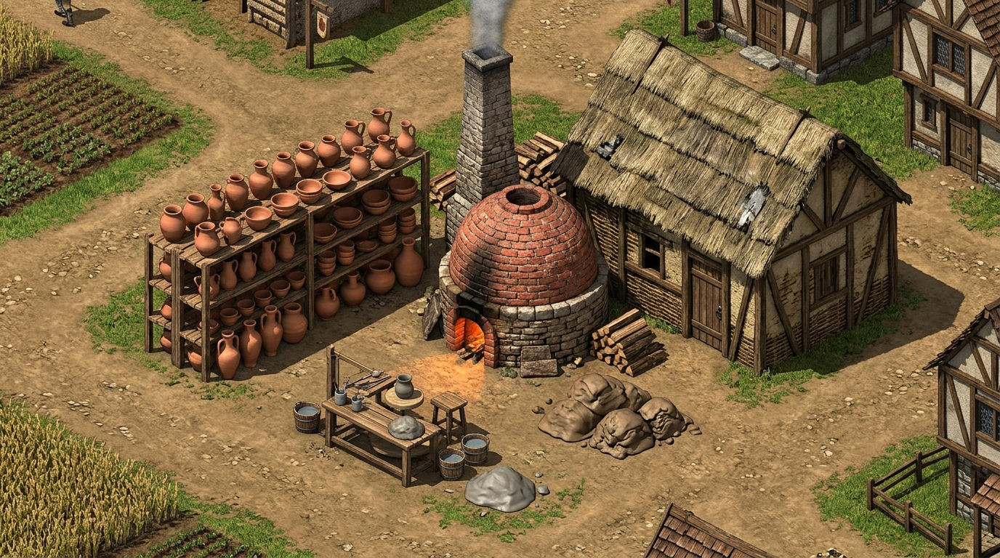

- **File Path:** [`reference_photos/potter_workshop.jpg`](../reference_photos/potter_workshop.jpg)
- **Associated 3D Model:** [`public/models/house_potter.glb`](../public/models/house_potter.glb)
- **Associated Worker:** `worker_master_potter`
- **Aspect Ratio:** `16:9`
- **Generation Prompt:**
  ```text
  2D isometric medieval city-builder game screenshot, late 1990s PC strategy game aesthetic, pre-rendered 3D sprites, medieval potter workshop and kiln yard, outdoor domed red brick pottery kiln with stone chimney and glowing stokehole, multi-tiered wooden shelves holding rows of terracotta clay pots, jugs, amphorae, and bowls, outdoor wooden potter bench with foot kick wheel, mounds of grey clay and water buckets, rustic wattle-and-daub cottage with weathered thatched roof, warm earthy color palette, crisp surface textures, hard directional drop shadows, orthographic projection, no UI
  ```
- **Architectural & Workspace Key Features:**
  - Wattle-and-daub cottage with cream loam plaster and low weathered thatched roof.
  - Circular red-brick updraft pottery kiln ($2.8\text{m}$ dia.) with arched glowing stokehole and stone flue chimney.
  - Outdoor wooden potting bench equipped with foot-operated kick-wheel and water buckets.
  - 3-tier wooden open drying rack displaying terracotta amphorae, clay jugs, bowls, and ridge tiles.
  - Raw clay mounds and firewood stacks.
  - Hanging guild sign: glazed terracotta amphora.

---

### Weaver's Half-Timber Workshop

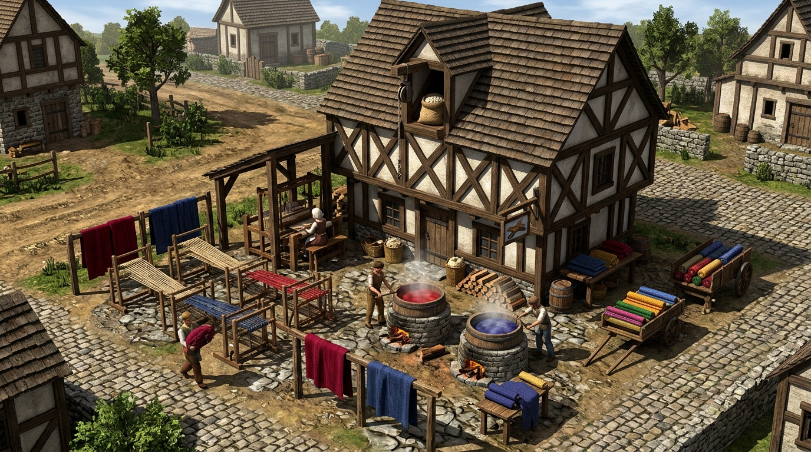

- **File Path:** [`reference_photos/weaver_workshop.jpg`](../reference_photos/weaver_workshop.jpg)
- **Associated 3D Model:** [`public/models/house_weaver.glb`](../public/models/house_weaver.glb)
- **Associated Worker:** `worker_master_weaver`
- **Aspect Ratio:** `16:9`
- **Generation Prompt:**
  ```text
  2D isometric medieval city-builder game screenshot, late 1990s PC strategy game aesthetic, pre-rendered 3D sprites, medieval weaver workshop and clothiers yard, handsome half-timbered building with St. Andrews diagonal cross braces, attic dormer with hoist pulley beam, outdoor wooden yarn stretching frames, steaming dye vats with draped dyed wool and linen fabrics in vibrant red and indigo blue drying on timber rails, bolts of woven broadcloth, warm earthy color palette, crisp surface textures, hard directional drop shadows, orthographic projection, no UI
  ```
- **Architectural & Workspace Key Features:**
  - Half-timbered structure with diagonal St. Andrew's cross braces (*krzyże św. Andrzeja*) and white lime plaster.
  - Attic dormer with projecting hoist beam, rope pulley, and suspended wool sack.
  - 2 circular stone dye cauldrons filled with steaming indigo blue and madder scarlet liquid dyes.
  - Long horizontal wooden rail racks with draped dyed wool and linen cloth drying in the breeze.
  - Vertical wooden yarn-stretching peg frame.
  - Clothier's handcart loaded with rolled broadcloth bolts.
  - Hanging guild sign: carved weaving shuttle and spindle.

---

### Riverside Watermill

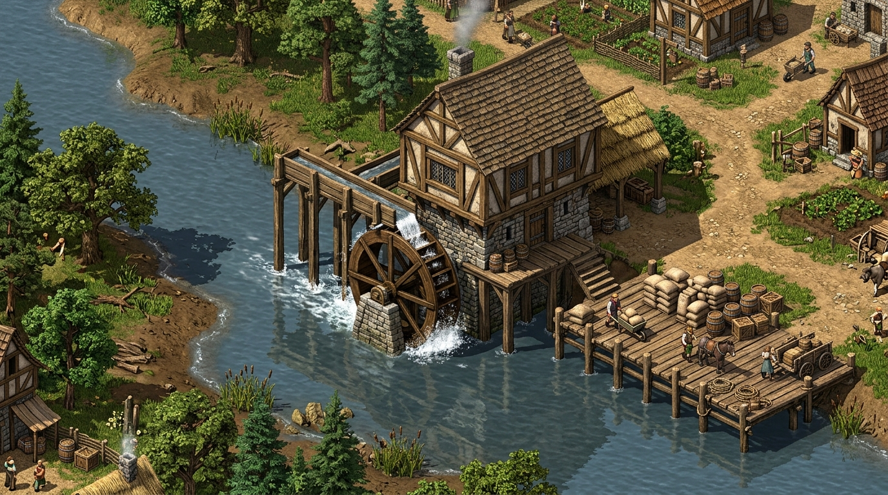

- **File Path:** [`reference_photos/watermill.jpg`](../reference_photos/watermill.jpg)
- **Associated 3D Model:** [`public/models/watermill.glb`](../public/models/watermill.glb)
- **Associated Workers:** `worker_miller_master`, `worker_flour_porter`
- **Aspect Ratio:** `16:9`
- **Generation Prompt:**
  ```text
  2D isometric medieval city-builder game screenshot, late 1990s PC strategy game aesthetic, pre-rendered 3D sprites, medieval watermill on riverbank, timber building on heavy oak stilts over the water, large rotating wooden undershot waterwheel with splashing water, timber flume race, riverside wooden pier with stacked burlap flour sacks and barrels, muted earthy color palette, crisp surface textures, hard directional drop shadows, orthographic projection, no UI
  ```
- **Architectural & Workspace Key Features:**
  - 2-story timber log mill cabin elevated on heavy oak stilts driven into the riverbed.
  - Undershot wooden waterwheel ($4.2\text{m}$ diameter) with 12 flat paddle blades and foaming splash effects.
  - Elevated timber flume race channeling river current onto the wheel paddles.
  - Quayside wooden boardwalk pier extending over water with stacked flour sacks and wooden hand barrow.
  - Sagging straw thatch roof with mossy eaves.

---

## 3. Worker & Citizen 3-View Turnaround Sheets (`reference_photos/workers/`)

These multi-view character turnaround model sheets provide exact orthographic silhouettes, historical costume details, work aprons, and tool specifications for procedural character creation and rigging in Blender.

---

### Master Blacksmith Turnaround

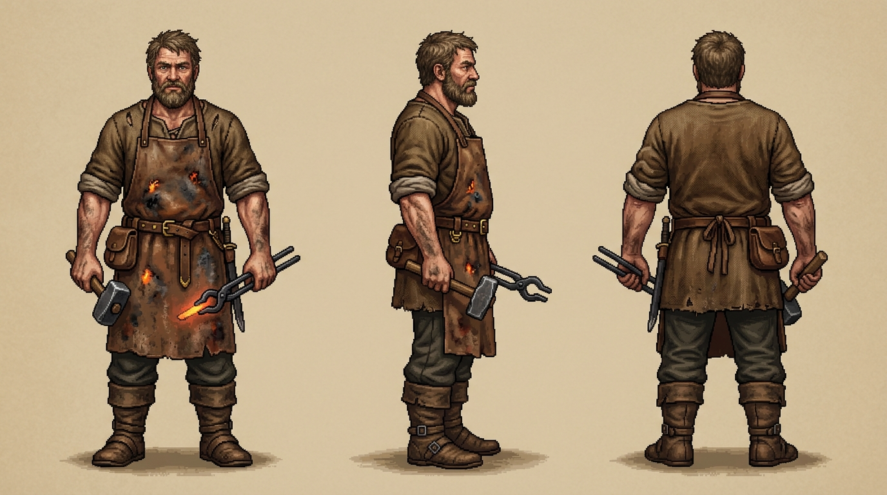

- **File Path:** [`reference_photos/workers/worker_blacksmith_turnaround.jpg`](../reference_photos/workers/worker_blacksmith_turnaround.jpg)
- **Associated 3D Model:** [`public/models/worker_blacksmith.glb`](../public/models/worker_blacksmith.glb)
- **Aspect Ratio:** `16:9`
- **Views Included:** Front View, Profile Side View, Rear View
- **Generation Prompt:**
  ```text
  Orthographic 3-view character model sheet showing front view, side profile view, and rear view side-by-side, 14th-century medieval master blacksmith, wearing heavy stained leather apron over brown woolen tunic, rolled-up linen sleeves, sturdy leather boots, holding iron tongs and blacksmith hammer, leather belt with pouch, neutral solid beige parchment background, crisp silhouette, studio lighting, late 1990s PC strategy game sprite reference, no UI
  ```
- **Costume & Equipment Details:**
  - Heavy soot-stained cowhide apron with forged steel buckles and rear tie straps.
  - Brown woolen tunic with rolled-up natural linen undergarment sleeves.
  - Double-wrapped leather tool belt supporting small utility knife sheath and coin purse.
  - Held craft tools: long-handled iron forging tongs with red-hot heated billet tip, and heavy steel cross-peen hammer.
  - Reinforced knee-high leather work boots.

---

### Artisan Baker Turnaround

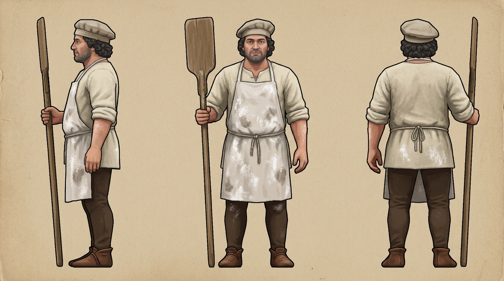

- **File Path:** [`reference_photos/workers/worker_baker_turnaround.jpg`](../reference_photos/workers/worker_baker_turnaround.jpg)
- **Associated 3D Model:** [`public/models/worker_baker.glb`](../public/models/worker_baker.glb)
- **Aspect Ratio:** `16:9`
- **Views Included:** Front View, Profile Side View, Rear View
- **Generation Prompt:**
  ```text
  Orthographic 3-view character model sheet showing front view, side profile view, and rear view side-by-side, 14th-century medieval artisan baker, white linen apron dusted with white flour over simple undyed woolen tunic, rolled-up sleeves, holding long wooden bread peel shovel, canvas baker cap, leather turnshoes, neutral solid beige parchment background, crisp silhouette, studio lighting, late 1990s PC strategy game sprite reference, no UI
  ```
- **Costume & Equipment Details:**
  - Bleached linen baker's apron heavily dusted with rye and wheat flour.
  - Puffed canvas chef's baker cap (*barett*) covering dark curls.
  - Undyed homespun woolen tunic with cord waist cinch.
  - Held craft tool: full-length $1.8\text{m}$ wooden bread peel paddle shovel.
  - Soft cowhide turnshoes.

---

### Master Tanner Turnaround

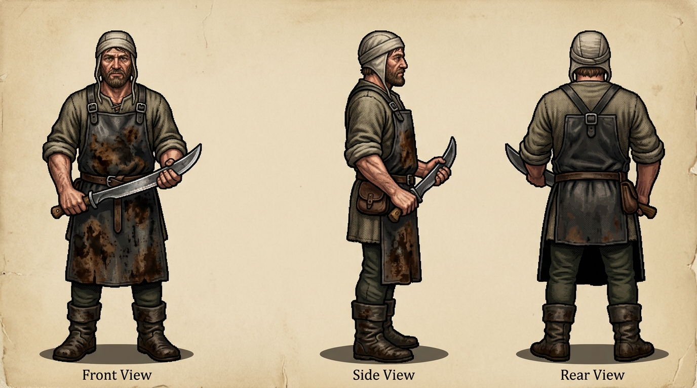

- **File Path:** [`reference_photos/workers/worker_tanner_turnaround.jpg`](../reference_photos/workers/worker_tanner_turnaround.jpg)
- **Associated 3D Model:** [`public/models/worker_tanner.glb`](../public/models/worker_tanner.glb)
- **Aspect Ratio:** `16:9`
- **Views Included:** Front View, Profile Side View, Rear View
- **Generation Prompt:**
  ```text
  Orthographic 3-view character model sheet showing front view, side profile view, and rear view side-by-side, 14th-century medieval tanner worker, heavy dark oiled leather apron stained with tanbark, thick rubberized water-resistant leather work boots, rolled-up woolen sleeves, holding a curved two-handed iron fleshing knife, cloth coif head covering, neutral solid beige parchment background, crisp silhouette, studio lighting, late 1990s PC strategy game sprite reference, no UI
  ```
- **Costume & Equipment Details:**
  - Water-resistant oiled leather apron stained with oak tanbark and lime solution.
  - Linen coif tied under the chin to keep hair free of chemical baths.
  - Thick, greased high water boots for wading into sunken lime vats.
  - Held craft tool: curved two-handled iron fleshing drawknife for scraping hides across the wooden beam.

---

### Master Carpenter & Joiner Turnaround

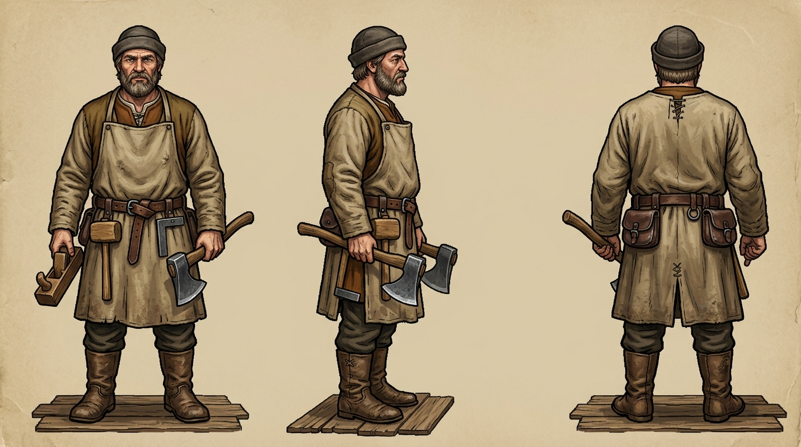

- **File Path:** [`reference_photos/workers/worker_carpenter_turnaround.jpg`](../reference_photos/workers/worker_carpenter_turnaround.jpg)
- **Associated 3D Model:** [`public/models/char_carpenter.glb`](../public/models/char_carpenter.glb)
- **Aspect Ratio:** `16:9`
- **Views Included:** Front View, Profile Side View, Rear View
- **Generation Prompt:**
  ```text
  Orthographic 3-view character model sheet showing front view, side profile view, and rear view side-by-side, 14th-century medieval master carpenter and joiner, wearing sturdy canvas work smock over earthy brown tunic, leather tool belt with iron square and mallet hanging, leather boots, holding a wooden block plane and broad carpenter felling axe, felt cap on head, neutral solid beige parchment background, crisp silhouette, studio lighting, late 1990s PC strategy game sprite reference, no UI
  ```
- **Costume & Equipment Details:**
  - Coarse canvas work apron over earthy homespun woolen tunic.
  - Heavy leather belt with hanging round wooden mallet and iron framing square.
  - Held craft tools: wooden block hand plane in left hand, broad-bladed carpenter felling axe in right hand.
  - Felt cap and durable leather work boots.

---

### Master Brewer & Cooper Turnaround

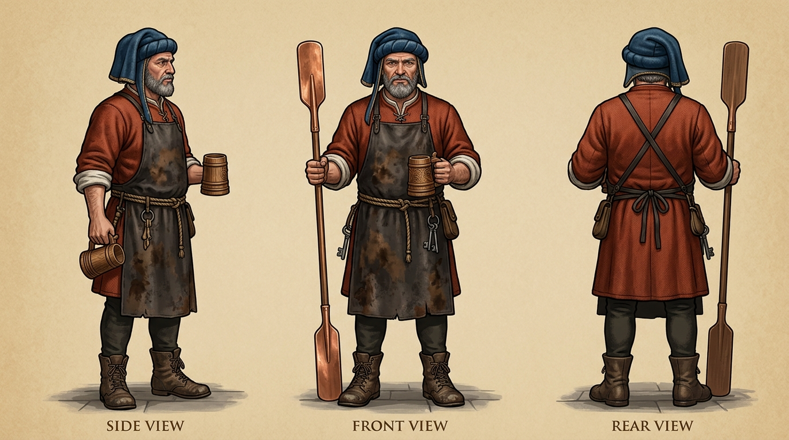

- **File Path:** [`reference_photos/workers/worker_brewer_turnaround.jpg`](../reference_photos/workers/worker_brewer_turnaround.jpg)
- **Associated 3D Model:** [`public/models/char_brewer.glb`](../public/models/char_brewer.glb)
- **Aspect Ratio:** `16:9`
- **Views Included:** Front View, Profile Side View, Rear View
- **Generation Prompt:**
  ```text
  Orthographic 3-view character model sheet showing front view, side profile view, and rear view side-by-side, 14th-century medieval master brewer, wearing stained dark leather bib apron over brick-red woolen cotte, rolled linen sleeves, sturdy work boots, holding a long polished copper mash paddle and wooden tasting tankard, velvet-trimmed chaperon hat on head, neutral solid beige parchment background, crisp silhouette, studio lighting, late 1990s PC strategy game sprite reference, no UI
  ```
- **Costume & Equipment Details:**
  - Deep brick-red woolen cotte with rolled natural linen sleeves.
  - Dark stained leather bib apron with brass buckles and crossed rear straps.
  - Velvet-trimmed chaperon hat with liripipe draped over the left shoulder.
  - Held craft tools: long polished copper mash paddle and turned wooden ale tankard.

---

### Master Potter Turnaround

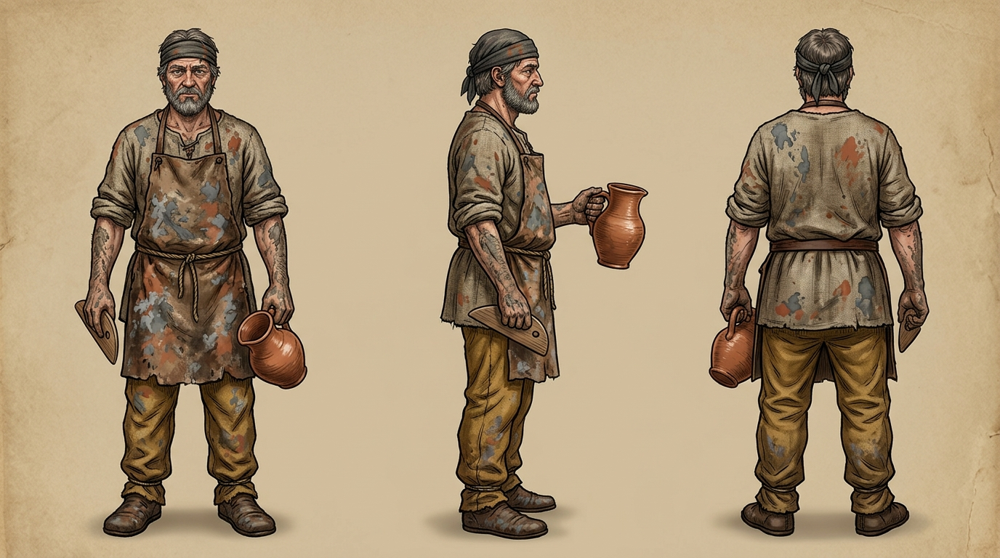

- **File Path:** [`reference_photos/workers/worker_potter_turnaround.jpg`](../reference_photos/workers/worker_potter_turnaround.jpg)
- **Associated 3D Model:** [`public/models/char_potter.glb`](../public/models/char_potter.glb)
- **Aspect Ratio:** `16:9`
- **Views Included:** Front View, Profile Side View, Rear View
- **Generation Prompt:**
  ```text
  Orthographic 3-view character model sheet showing front view, side profile view, and rear view side-by-side, 14th-century medieval master potter, wearing coarse linen tunic spattered with grey and terracotta clay, earthy ochre trousers, tied cloth headband on head, rolled sleeves, bare forearms with clay splatters, holding a wooden pottery shaping rib and a freshly thrown terracotta jug, neutral solid beige parchment background, crisp silhouette, studio lighting, late 1990s PC strategy game sprite reference, no UI
  ```
- **Costume & Equipment Details:**
  - Linen tunic and apron heavily spattered with damp river clay and fired terracotta powder.
  - Earthy ochre trousers and rawhide turnshoes.
  - Knotted cloth headband keeping curls clear of the kick-wheel.
  - Held craft tools: flat wooden shaping rib and freshly thrown double-handled clay amphora.

---

### Master Weaver Turnaround

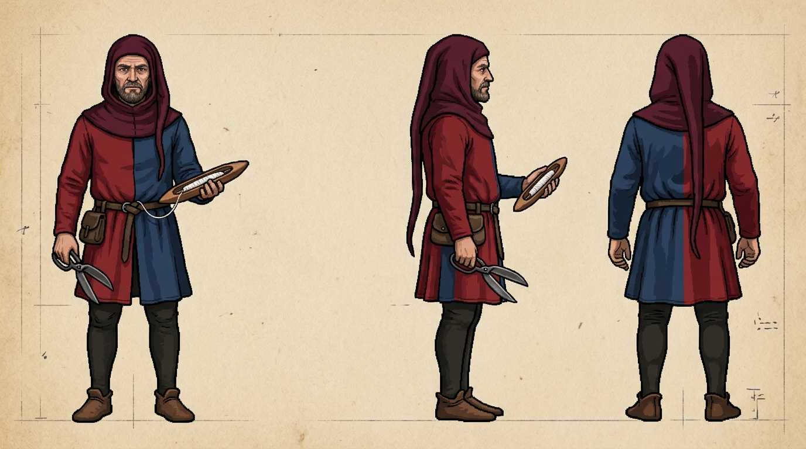

- **File Path:** [`reference_photos/workers/worker_weaver_turnaround.jpg`](../reference_photos/workers/worker_weaver_turnaround.jpg)
- **Associated 3D Model:** [`public/models/char_weaver.glb`](../public/models/char_weaver.glb)
- **Aspect Ratio:** `16:9`
- **Views Included:** Front View, Profile Side View, Rear View
- **Generation Prompt:**
  ```text
  Orthographic 3-view character model sheet showing front view, side profile view, and rear view side-by-side, 14th-century medieval master weaver and clothier, wearing deep madder red and indigo blue burgher cotte tunic, dark chausses, leather turnshoes, burgundy woolen hood with hanging liripipe tail, holding a polished hardwood weaving shuttle threaded with white yarn and large tailor shears, neutral solid beige parchment background, crisp silhouette, studio lighting, late 1990s PC strategy game sprite reference, no UI
  ```
- **Costume & Equipment Details:**
  - Fashionable mi-parti dyed woolen cotte (madder red right half, indigo blue left half).
  - Burgundy woolen hood with long liripipe tail draping down the back.
  - Embroidered cloth belt with coin pouch.
  - Held craft tools: carved polished hardwood shuttle with wound yarn spool and iron shears.

---

### City Halberdier & Gate Guard Turnaround

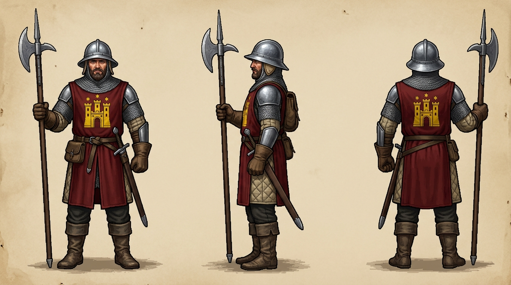

- **File Path:** [`reference_photos/workers/worker_guard_turnaround.jpg`](../reference_photos/workers/worker_guard_turnaround.jpg)
- **Associated 3D Model:** [`public/models/char_guard.glb`](../public/models/char_guard.glb)
- **Aspect Ratio:** `16:9`
- **Views Included:** Front View, Profile Side View, Rear View
- **Generation Prompt:**
  ```text
  Orthographic 3-view character model sheet showing front view, side profile view, and rear view side-by-side, 14th-century medieval city guard and halberdier, wearing quilted padded gambeson under a dark red city coat of arms tabard, chainmail coif with polished steel kettle hat sallet helmet, leather armguards and sturdy boots, holding a tall 2.2-meter steel polearm halberd with forged axe blade and spear spike, short arming sword in scabbard at hip, neutral solid beige parchment background, crisp silhouette, studio lighting, late 1990s PC strategy game sprite reference, no UI
  ```
- **Costume & Equipment Details:**
  - Dark red heraldic tabard emblazoned with golden city castle gate crest.
  - Quilted protective gambeson undergarment and chainmail aventail.
  - Polished steel kettle hat helmet with broad deflected rim.
  - Held craft tools: 2.2m steel polearm halberd with crescent axe blade and top spear spike; arming sword at hip.

---

### Dominican Friar Herb Gardener Turnaround

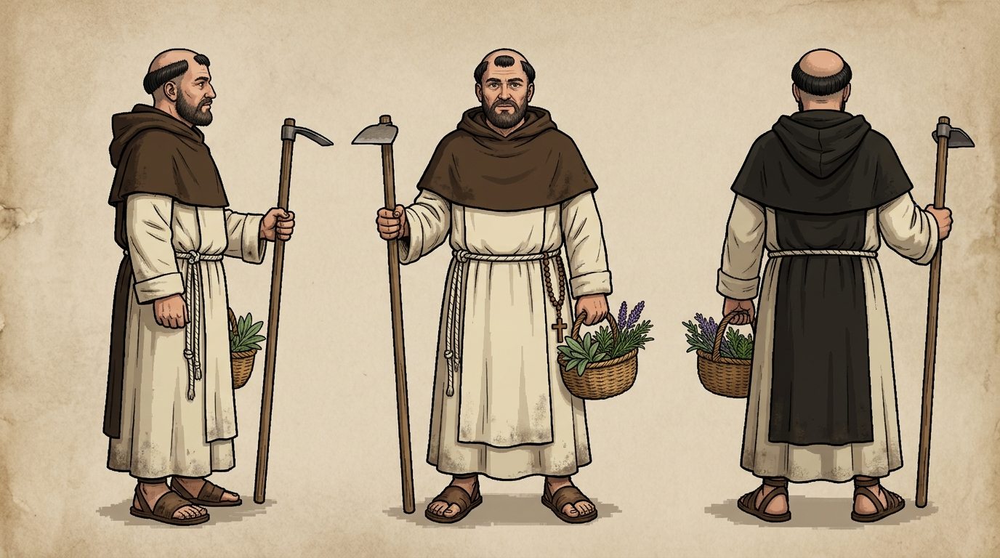

- **File Path:** [`reference_photos/workers/worker_monk_turnaround.jpg`](../reference_photos/workers/worker_monk_turnaround.jpg)
- **Associated 3D Model:** [`public/models/char_friar.glb`](../public/models/char_friar.glb)
- **Aspect Ratio:** `16:9`
- **Views Included:** Front View, Profile Side View, Rear View
- **Generation Prompt:**
  ```text
  Orthographic 3-view character model sheet showing front view, side profile view, and rear view side-by-side, 14th-century Dominican friar and monastery herb gardener, wearing cream unbleached wool habit tunic under dark brown woolen hooded scapular, knotted white rope cincture cord around waist with wooden rosary beads, leather sandals, tonsured hairstyle, holding a wooden garden hoe and a small wicker herb gathering basket filled with sage and lavender, neutral solid beige parchment background, crisp silhouette, studio lighting, late 1990s PC strategy game sprite reference, no UI
  ```
- **Costume & Equipment Details:**
  - Authentic Order of Preachers habit: undyed cream wool tunic and dark brown scapular.
  - Knotted white rope cincture cord with carved wooden rosary beads and crucifix.
  - Tonsured ring hairstyle and leather sandals.
  - Held craft tools: wooden weeding hoe and round wicker basket filled with fresh sage and lavender.

---

### Peasant Farmer & Scyther Turnaround

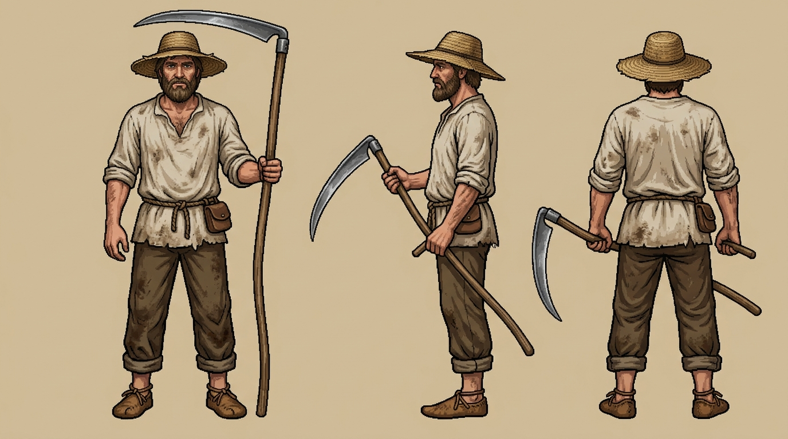

- **File Path:** [`reference_photos/workers/worker_farmer_turnaround.jpg`](../reference_photos/workers/worker_farmer_turnaround.jpg)
- **Associated 3D Model:** [`public/models/char_farmer.glb`](../public/models/char_farmer.glb)
- **Aspect Ratio:** `16:9`
- **Views Included:** Front View, Profile Side View, Rear View
- **Generation Prompt:**
  ```text
  Orthographic 3-view character model sheet showing front view, side profile view, and rear view side-by-side, 14th-century medieval peasant farmer and scyther, wearing loose homespun natural undyed linen shirt, rolled-up earthy trousers, wide-brimmed woven straw sun hat, simple rawhide moccasin shoes, holding a long two-handed curved steel harvest scythe with bent wooden snath, small whetstone pouch at rope belt, neutral solid beige parchment background, crisp silhouette, studio lighting, late 1990s PC strategy game sprite reference, no UI
  ```
- **Costume & Equipment Details:**
  - Loose homespun linen work shirt with open collar and rope belt.
  - Wide-brimmed sun-bleached woven straw harvest hat.
  - Rawhide turnshoes and wooden whetstone horn scabbard.
  - Held craft tools: 1.8m curved harvest scythe with two offset wooden snath handgrips.

---

### Master Stonemason Turnaround

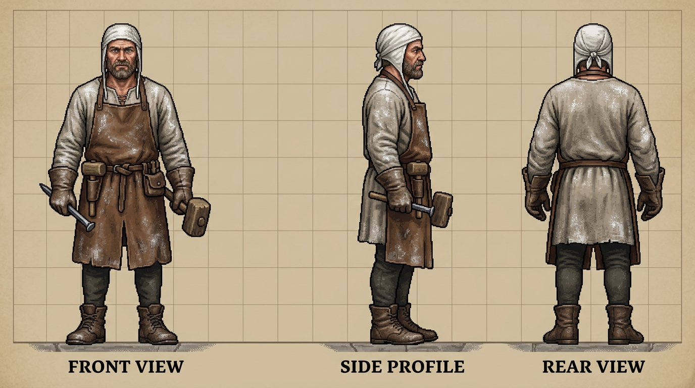

- **File Path:** [`reference_photos/workers/worker_stonemason_turnaround.jpg`](../reference_photos/workers/worker_stonemason_turnaround.jpg)
- **Associated 3D Model:** [`public/models/char_stonemason.glb`](../public/models/char_stonemason.glb)
- **Aspect Ratio:** `16:9`
- **Views Included:** Front View, Profile Side View, Rear View
- **Generation Prompt:**
  ```text
  Orthographic 3-view character model sheet showing front view, side profile view, and rear view side-by-side, 14th-century medieval master stone mason and stonecutter, wearing heavy linen smock dusted with white stone powder, split leather knee-length apron, dark hose, thick leather work gloves, tied white linen coif, holding an iron pointed stonecutter chisel and heavy wooden mallet, neutral solid beige parchment background, crisp silhouette, studio lighting, late 1990s PC strategy game sprite reference, no UI
  ```
- **Costume & Equipment Details:**
  - Linen smock and split leather apron dusted with pale limestone ashlar powder.
  - Tied linen coif and thick heavy gauntlets.
  - Sturdy double-soled work boots.
  - Held craft tools: round beechwood stonecutter's mallet and pointed forged iron chisel.

---

### Patrician Merchant & Councilman Turnaround

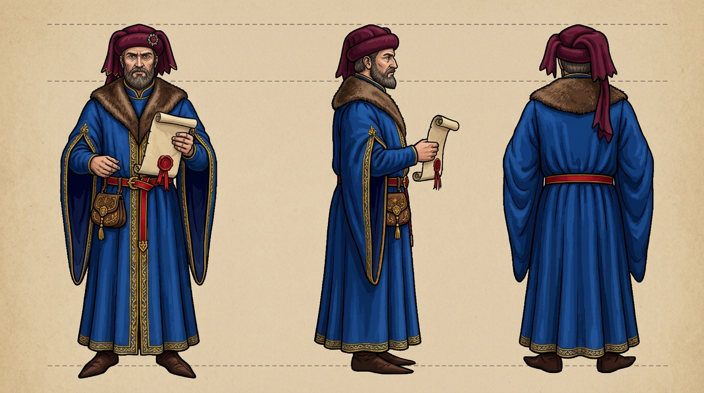

- **File Path:** [`reference_photos/workers/worker_patrician_turnaround.jpg`](../reference_photos/workers/worker_patrician_turnaround.jpg)
- **Associated 3D Model:** [`public/models/char_merchant.glb`](../public/models/char_merchant.glb)
- **Aspect Ratio:** `16:9`
- **Views Included:** Front View, Profile Side View, Rear View
- **Generation Prompt:**
  ```text
  Orthographic 3-view character model sheet showing front view, side profile view, and rear view side-by-side, 14th-century medieval patrician merchant and city councilman, wearing luxurious royal blue woolen houppelande robe with brown beaver fur collar trim and wide sleeves, fine scarlet belt with gold buckle and embossed leather coin purse, pointed leather poulaines shoes, padded burgundy chaperon hat with cockade broach, holding an official parchment ledger scroll with red wax seal, neutral solid beige parchment background, crisp silhouette, studio lighting, late 1990s PC strategy game sprite reference, no UI
  ```
- **Costume & Equipment Details:**
  - Floor-length royal blue houppelande gown with wide dagged sleeves and beaver fur trim.
  - Padded burgundy velvet chaperon hat with gold cockade.
  - Pointed leather poulaines turnshoes.
  - Held craft tools: royal charter trade ledger scroll with hanging red wax seal.

---

### Burgher Townswoman & Market Trader Turnaround

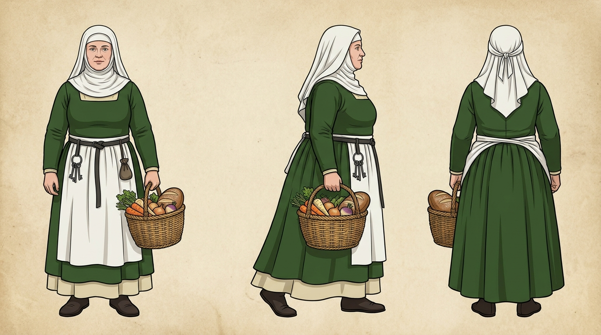

- **File Path:** [`reference_photos/workers/worker_townswoman_turnaround.jpg`](../reference_photos/workers/worker_townswoman_turnaround.jpg)
- **Associated 3D Model:** [`public/models/char_townswoman.glb`](../public/models/char_townswoman.glb)
- **Aspect Ratio:** `16:9`
- **Views Included:** Front View, Profile Side View, Rear View
- **Generation Prompt:**
  ```text
  Orthographic 3-view character model sheet showing front view, side profile view, and rear view side-by-side, 14th-century medieval burgher townswoman and market trader, wearing warm forest green woolen kirtle gown over cream linen underdress, crisp white linen apron with neat folds, folded white linen wimple and veil covering hair, leather turnshoes, holding a woven wicker market basket filled with fresh root vegetables and round sourdough bread, key ring hanging from cloth belt, neutral solid beige parchment background, crisp silhouette, studio lighting, late 1990s PC strategy game sprite reference, no UI
  ```
- **Costume & Equipment Details:**
  - Forest green woolen kirtle gown with cream linen chemise cuffs.
  - Folded white linen wimple, barbette, and veil.
  - Iron key ring and household coin pouch hanging from woven sash.
  - Held craft tools: double-handled wicker market basket loaded with fresh parsnips, onions, carrots, and crusty bread.

---

### Forest Woodcutter Turnaround

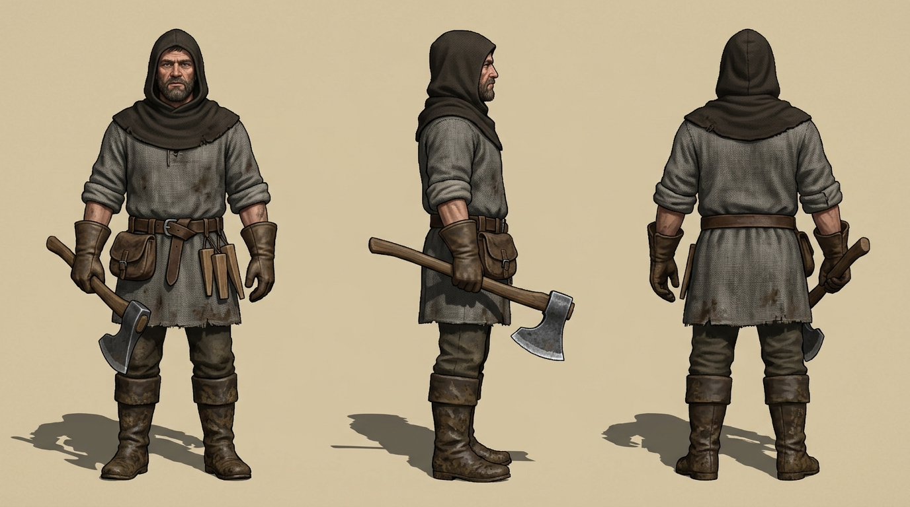

- **File Path:** [`reference_photos/workers/worker_woodcutter_turnaround.jpg`](../reference_photos/workers/worker_woodcutter_turnaround.jpg)
- **Associated 3D Model:** [`public/models/char_woodcutter.glb`](../public/models/char_woodcutter.glb)
- **Aspect Ratio:** `16:9`
- **Views Included:** Front View, Profile Side View, Rear View
- **Generation Prompt:**
  ```text
  Orthographic 3-view character model sheet showing front view, side profile view, and rear view side-by-side, 14th-century medieval forest woodcutter, wearing dark charcoal-brown woolen hood covering neck and shoulders, sturdy coarse grey smock with rolled sleeves, heavy leather forester gauntlets, tall mud-spattered work boots, holding a heavy double-bitted iron felling axe rested on ground, felling wedges and woodman's belt pouch at waist, neutral solid beige parchment background, crisp silhouette, studio lighting, late 1990s PC strategy game sprite reference, no UI
  ```
- **Costume & Equipment Details:**
  - Weathered grey woolen tunic and charcoal cowl hood covering shoulders.
  - Heavy leather woodcutter's belt holding split oak felling wedges.
  - Mud-caked high forest boots.
  - Held craft tools: heavy forged iron broad felling axe with long curved ash haft.

---

### Character Kit Reference Sheets (to generate)

Inputs for the kit pipeline (`build_characters.py`, "Kit pipeline (v2)"). The turnarounds above bake a held tool into the pose; a kit animates arms and attaches tools to the hand, so these sheets show **empty hands in a relaxed A-pose**. Save each as `reference_photos/workers/kit/<file>`. All sheets share this tail, which keeps them consistent with the turnarounds:

```text
neutral solid beige parchment background, crisp silhouette, even studio lighting, orthographic, no perspective, no text labels, late 1990s PC strategy game sprite reference, no UI
```

**1. Base bodies, 4 sheets, 16:9** (`body_man.jpg`, `body_woman.jpg`, `body_old_man.jpg`, `body_youth.jpg`). They drive the shared body proportions.

```text
Orthographic 3-view character model sheet showing front view, side profile view, and rear view side-by-side of the same person, 14th-century Central European [adult craftsman of average build, about 35 years old | adult townswoman, about 30, wearing an ankle-length plain kirtle | elderly man, about 65, slightly stooped | youth apprentice, about 15], standing in a relaxed A-pose with arms angled 20 degrees away from the body, empty open hands, feet shoulder-width apart, plain undyed wool tunic, hose and leather turnshoes, bare head with short hair, [tail]
```

**2. Face sheets, 2 sheets, 16:9** (`faces_men.jpg`, `faces_women.jpg`). These guide the eyes, brows, nose and beard shapes at about 25 px tall.

```text
Character face reference sheet, grid of 8 heads, each shown as a front view and a side profile, 14th-century Central European [working men of varied ages 18 to 70: clean-shaven, stubble, short beard, full beard, moustache, balding, grey-haired | working women of varied ages 18 to 65, hair covered by a white linen kerchief, a wimple and veil, or a linen coif], strong readable features, simple shapes, earthy skin tones, [tail]
```

**3. Variation lineups, 1 sheet per trade, 16:9** (`lineup_<trade>.jpg`). They define what stays fixed in a trade (its signature) and what varies. Tanner and blacksmith come first, since they are the kit pilot.

```text
Character lineup sheet, five different 14th-century [tanners | blacksmiths] standing side by side in front view, same trade signature on all five [tanner: dark oiled leather apron, high greased boots, curved two-handled fleshing knife | blacksmith: long leather apron, linen shirt with rolled sleeves, cross-peen hammer], varied in every other way: two women and three men, ages from apprentice to old master, different builds, different hair, beards and head coverings (linen coif, felt skullcap, wool hood, bare head, kerchief), tunics in different undyed and plant-dyed wool colours (madder red, woad blue, weld yellow, undyed brown and grey), [tail]
```

---

These panoramic concept artworks define the regional geography, atmospheric lighting, and architectural hierarchy of Lublin Anno Domini 1392.

---

### Artisan and Brewery District


- **File Path:** [`concept_art/artisan and brewery district.jpg`](../concept_art/artisan%20and%20brewery%20district.jpg)
- **Districts Covered:** Bramowa Quarter, Craft Enclaves, Suburbs
- **Key Features:** Central double-chimney brick firing kiln, half-timbered brewery malthouses, outdoor pottery shelves, log cabins, dirt roads, cart traffic, and active craftsmen.
- **Generation Prompt:**
  ```text
  2D isometric medieval city-builder game screenshot, late 1990s PC strategy game aesthetic, pre-rendered 3D sprites, artisan and brewery district, masonry firing kiln with smoking double chimneys, half-timbered brewery malthouse, outdoor pottery drying shelves, beer barrels, log cabins, Central European architecture, muted earthy color palette, olive green grass, worn dirt roads, tiny medieval townsfolk, hard directional drop shadows, orthographic projection, no UI
  ```

---

### Brick Monastery with a Cloister Garden

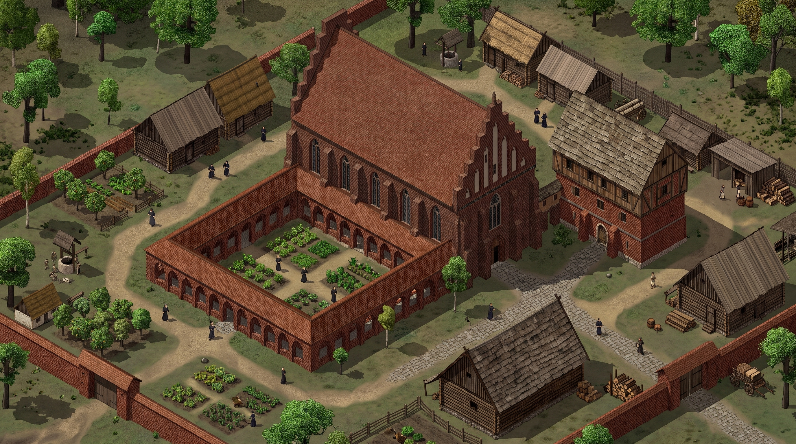

- **File Path:** [`concept_art/brick_monastery_with_a_cloister_garden.jpg`](../concept_art/brick_monastery_with_a_cloister_garden.jpg)
- **Associated 3D Model:** [`public/models/monastery_cloister.glb`](../public/models/monastery_cloister.glb)
- **Key Features:** Dominican Friary quadrangle, pointed brick arcaded cloister walks, enclosed quad with geometric raised herbal beds, central stone fountain basin, monks in white and brown habits.
- **Generation Prompt:**
  ```text
  2D isometric medieval city-builder game screenshot, late 1990s PC strategy game aesthetic, pre-rendered 3D sprites, brick monastery with a cloister garden, Gothic brick quadrangle, pointed arcades, geometric raised medicinal herb planting beds, stone fountain basin, monks in robes, Central European Brick Gothic, muted earthy color palette, orthographic projection, no UI
  ```

---

### Fortified Castle Courtyard & Bailey

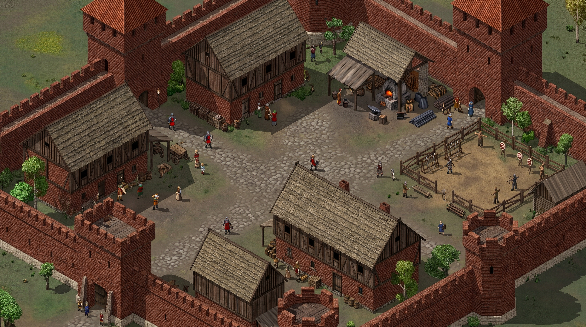

- **File Path:** [`concept_art/fortified_castle_courtyard.jpg`](../concept_art/fortified_castle_courtyard.jpg)
- **Associated 3D Model:** [`public/models/castle_donjon.glb`](../public/models/castle_donjon.glb), [`public/models/archery_yard.glb`](../public/models/archery_yard.glb)
- **Key Features:** Wzgórze Zamkowe plateau, cylindrical limestone donjon keep, brick battlements with machicolations, timber hoardings, bailey guards, cobblestones, and outer curtain walls.
- **Generation Prompt:**
  ```text
  2D isometric medieval city-builder game screenshot, late 1990s PC strategy game aesthetic, pre-rendered 3D sprites, fortified castle courtyard and bailey on elevated hill, Romanesque limestone donjon keep, brick battlements with machicolations, timber hoardings, knights and guards with spears, cobblestones, orthographic projection, no UI
  ```

---

### Fortified River Crossing with Watermill

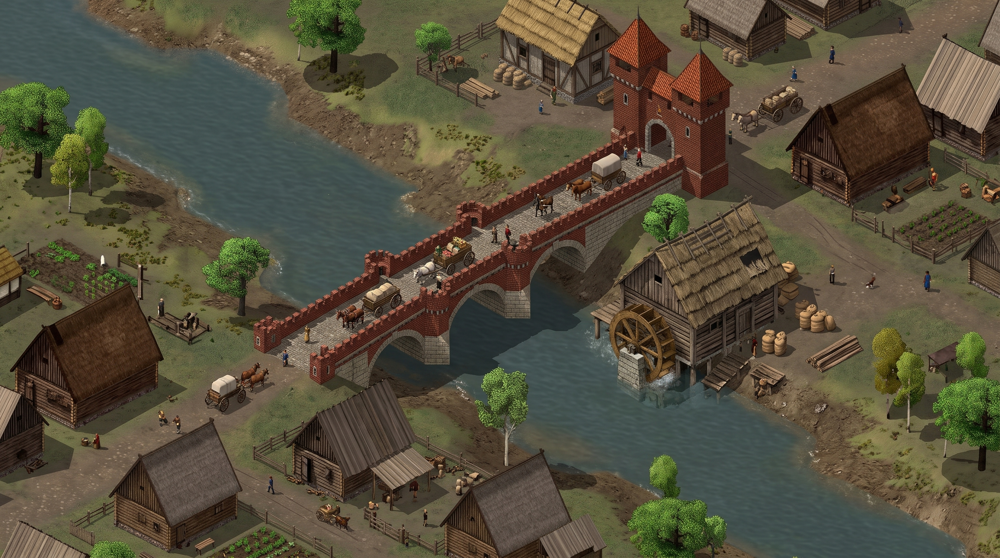

- **File Path:** [`concept_art/fortified_river_crossing_with_a_watermill.jpg`](../concept_art/fortified_river_crossing_with_a_watermill.jpg)
- **Associated 3D Models:** [`public/models/watermill.glb`](../public/models/watermill.glb), [`public/models/gate_grodzka.glb`](../public/models/gate_grodzka.glb)
- **Key Features:** Fortified multi-arch brick and stone bridge spanning the Czechówka river, twin gatehouse towers with crenellations, horse carts crossing, and riverbank watermill with active waterwheel.
- **Generation Prompt:**
  ```text
  2D isometric medieval city-builder game screenshot, late 1990s PC strategy game aesthetic, pre-rendered 3D sprites, fortified river crossing with a watermill, arched brick and stone bridge with fortified gate towers, horse-drawn carts crossing river, wooden watermill on river stilts with large undershot paddle waterwheel, flour sacks on dock, orthographic projection, no UI
  ```

---

### Hillside Iron Mine & Smelting Camp


- **File Path:** [`concept_art/hillside iron mine and smelting camp.jpg`](../concept_art/hillside%20iron%20mine%20and%20smelting%20camp.jpg)
- **Associated 3D Model:** [`public/models/blacksmith_workshop.glb`](../public/models/blacksmith_workshop.glb)
- **Key Features:** Timber-shored mine adits cut into loess terrace, bloomery smelting furnace with glowing taphole, miners with pickaxes and ore barrows, coal ricks, and log bunkhouses.
- **Generation Prompt:**
  ```text
  2D isometric medieval city-builder game screenshot, late 1990s PC strategy game aesthetic, pre-rendered 3D sprites, hillside iron mine and smelting camp, timber adit mine entrances into loess cliff, bloomery smelting furnace with glowing ore and stone chimneys, miners with pickaxes and ore carts, coal heaps, timber cabins, orthographic projection, no UI
  ```

---

### Riverside Harbor Wharves

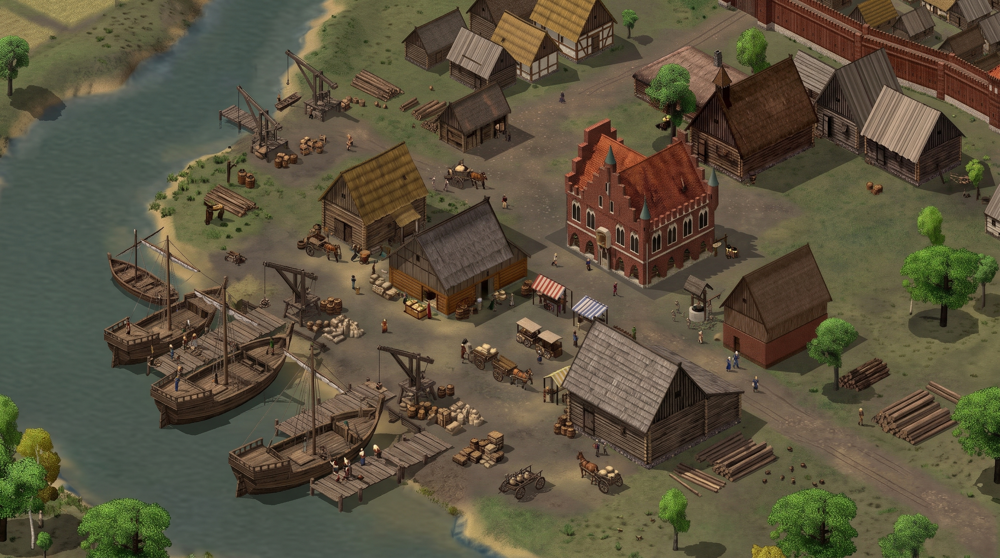

- **File Path:** [`concept_art/riverside_harbor.jpg`](../concept_art/riverside_harbor.jpg)
- **Associated 3D Model:** [`public/models/river_harbor.glb`](../public/models/river_harbor.glb)
- **Key Features:** Oak boardwalk wharves on pilings along the Bystrzyca river, moored 14m clinker-built wooden cog ships, cylindrical treadwheel crane, cargo barrels, grain sacks, stevedores, and town hall in background.
- **Generation Prompt:**
  ```text
  2D isometric medieval city-builder game screenshot, late 1990s PC strategy game aesthetic, pre-rendered 3D sprites, riverside harbor and merchant wharves, wooden piers and bulkheads on riverbank, clinker-built wooden cog ships moored to bollards, cylindrical wooden treadwheel crane, cargo barrels and grain sacks, merchants and stevedores, Gothic brick town hall in background, orthographic projection, no UI
  ```

---

### Rural Farming Village & Post Windmill

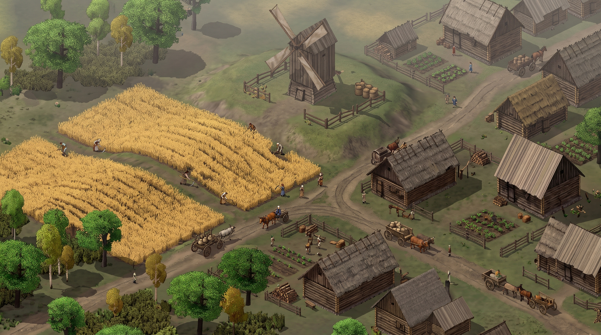

- **File Path:** [`concept_art/rural_farming_village.jpg`](../concept_art/rural_farming_village.jpg)
- **Associated 3D Models:** [`public/models/windmill.glb`](../public/models/windmill.glb), [`public/models/house_timber_log.glb`](../public/models/house_timber_log.glb)
- **Key Features:** Golden ripe wheat fields swaths with scything peasants, hilltop post windmill with 4-blade canvas sails, thatched log cottages with fenced cabbage gardens, dirt cart crossroads.
- **Generation Prompt:**
  ```text
  2D isometric medieval city-builder game screenshot, late 1990s PC strategy game aesthetic, pre-rendered 3D sprites, rural farming village outside fortified city, golden wheat fields with peasants harvesting with curved scythes, hilltop wooden post windmill with 4-blade canvas sails, rustic thatched log cottages with fenced vegetable gardens, dirt crossroads with ox carts, orthographic projection, no UI
  ```

---

### Stone Quarry & Logging Camp

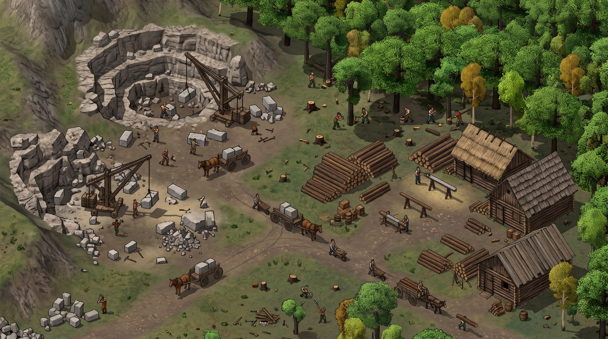

- **File Path:** [`concept_art/stone_quarry_and_logging_camp.jpg`](../concept_art/stone_quarry_and_logging_camp.jpg)
- **Associated 3D Models:** [`public/models/stone_quarry.glb`](../public/models/stone_quarry.glb), [`public/models/logging_camp.glb`](../public/models/logging_camp.glb)
- **Key Features:** Terraced limestone rock quarry pit with heavy timber A-frame jib crane hoisting ashlar blocks, adjacent logging camp with elevated two-man pit-saw trestle over sawdust pit, log stacks, woodcutters.
- **Generation Prompt:**
  ```text
  2D isometric medieval city-builder game screenshot, late 1990s PC strategy game aesthetic, pre-rendered 3D sprites, stone quarry and logging camp, terraced limestone quarry pit with timber A-frame derrick crane hoisting cut ashlar blocks, stonemasons dressing stone, adjacent logging camp with two-man pit-saw trestle over sawdust pit, pine log ricks, woodcutters with broadaxes, orthographic projection, no UI
  ```

---

### Tournament Fairground Outside City Walls


- **File Path:** [`concept_art/tournament fairground outside the city walls.jpg`](../concept_art/tournament%20fairground%20outside%20the%20city%20walls.jpg)
- **Associated 3D Models:** [`public/models/curtain_wall.glb`](../public/models/curtain_wall.glb), [`public/models/curtain_tower.glb`](../public/models/curtain_tower.glb)
- **Key Features:** Striped heraldic tournament pavilions, jousting tilt rail lane, armored knights on warhorses, viewing stands, city curtain walls and brick gate towers in background.
- **Generation Prompt:**
  ```text
  2D isometric medieval city-builder game screenshot, late 1990s PC strategy game aesthetic, pre-rendered 3D sprites, tournament fairground outside the city walls, royal pavilion tents with heraldic striped canopies, jousting tilt rail lane with armored knights on caparisoned warhorses, royal viewing stand, cheering burghers, fortified curtain wall and towers in background, orthographic projection, no UI
  ```

---

## 5. In-Engine Screenshots & Visual Deliverables

### Final High-Resolution Simulation View
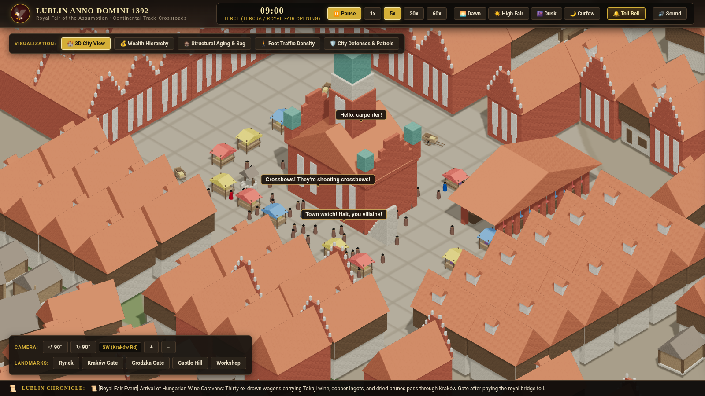
- **File Path:** [`public/screenshot_final.png`](../public/screenshot_final.png)
- **Resolution:** $1920 \times 1080$
- **Engine:** Three.js Orthographic Isometric Pipeline, PCF Soft Shadows (`shadowMap.bias = -0.0003`), Procedural Cobblestone Ground Canvas.
- **Active Entities:** 580 Non-Overlapping Parcels, 31 Blender GLB Assets, 1,500 Living Citizens with clockwork bell schedules.

---

## 6. Summary Matrix: Image to 3D Model Mapping

| # | Image File | Category | Associated 3D GLB Asset | Associated Worker / Activity |
|---|---|---|---|---|
| 1 | `reference_photos/baker_house/front.jpg` | Workshop 3-View Set (Front) | `public/models/baker_house.glb` | `worker_baker` (sliding bread into oven) |
| 2 | `reference_photos/baker_house/side.jpg` | Workshop 3-View Set (Side Profile) | `public/models/baker_house.glb` | `worker_baker` (firewood & flour delivery) |
| 3 | `reference_photos/baker_house/back.jpg` | Workshop 3-View Set (Rear Yard) | `public/models/baker_house.glb` | `worker_baker` (stokehole & ash cleanup) |
| 4 | `reference_photos/blacksmith_workshop/front.jpg` | Workshop 3-View Set (Front) | `public/models/blacksmith_workshop.glb` | `worker_blacksmith` (forging on anvil) |
| 5 | `reference_photos/blacksmith_workshop/side.jpg` | Workshop 3-View Set (Side Profile) | `public/models/blacksmith_workshop.glb` | `worker_blacksmith` (coal bunker & quench trough) |
| 6 | `reference_photos/blacksmith_workshop/back.jpg` | Workshop 3-View Set (Rear Yard) | `public/models/blacksmith_workshop.glb` | `worker_blacksmith` (bloomery smelting & iron racks) |
| 7 | `reference_photos/tanner_workshop/front.jpg` | Workshop Reference (Primary) | `public/models/tanner_workshop.glb` | `worker_tanner` (scraping hide on fleshing beam) |
| 8 | `reference_photos/brewer_malthouse/front.jpg` | Workshop Reference (Primary) | `public/models/brewer_malthouse.glb` | `worker_brewer` & cooper |
| 9 | `reference_photos/potter_workshop/front.jpg` | Workshop Reference (Primary) | `public/models/potter_workshop.glb` | `worker_potter` (throwing clay amphora) |
| 10 | `reference_photos/weaver_workshop/front.jpg` | Workshop Reference (Primary) | `public/models/weaver_workshop.glb` | `worker_weaver` (operating loom & dyeing) |
| 11 | `reference_photos/watermill/front.jpg` | Workshop Reference (Primary) | `public/models/watermill.glb` | `worker_miller` & flour porters |
| 12 | `reference_photos/workers/worker_blacksmith_turnaround.jpg` | Character 3-View Turnaround | `public/models/char_blacksmith.glb` | Master Blacksmith (leather apron, tongs, hammer) |
| 13 | `reference_photos/workers/worker_baker_turnaround.jpg` | Character 3-View Turnaround | `public/models/char_baker.glb` | Artisan Baker (flour-dusted apron, bread peel) |
| 14 | `reference_photos/workers/worker_tanner_turnaround.jpg` | Character 3-View Turnaround | `public/models/char_tanner.glb` | Master Tanner (oiled apron, fleshing drawknife) |
| 15 | `reference_photos/workers/worker_carpenter_turnaround.jpg` | Character 3-View Turnaround | `public/models/char_carpenter.glb` | Master Carpenter (canvas smock, block plane, axe) |
| 16 | `reference_photos/workers/worker_brewer_turnaround.jpg` | Character 3-View Turnaround | `public/models/char_brewer.glb` | Master Brewer (red cotte, copper paddle, tankard) |
| 17 | `reference_photos/workers/worker_potter_turnaround.jpg` | Character 3-View Turnaround | `public/models/char_potter.glb` | Master Potter (clay smock, shaping rib, jug) |
| 18 | `reference_photos/workers/worker_weaver_turnaround.jpg` | Character 3-View Turnaround | `public/models/char_weaver.glb` | Master Weaver (mi-parti cotte, shuttle, shears) |
| 19 | `reference_photos/workers/worker_guard_turnaround.jpg` | Character 3-View Turnaround | `public/models/char_guard.glb` | Town Guard (sallet helmet, tabard, halberd) |
| 20 | `reference_photos/workers/worker_monk_turnaround.jpg` | Character 3-View Turnaround | `public/models/char_friar.glb` | Dominican Friar (monastic habit, hoe, herb basket) |
| 21 | `reference_photos/workers/worker_farmer_turnaround.jpg` | Character 3-View Turnaround | `public/models/char_farmer.glb` | Peasant Farmer (straw hat, linen shirt, scythe) |
| 22 | `reference_photos/workers/worker_stonemason_turnaround.jpg` | Character 3-View Turnaround | `public/models/char_stonemason.glb` | Stone Mason (stone smock, leather apron, mallet, chisel) |
| 23 | `reference_photos/workers/worker_patrician_turnaround.jpg` | Character 3-View Turnaround | `public/models/char_merchant.glb` | Patrician Merchant (houppelande, fur, sealed scroll) |
| 24 | `reference_photos/workers/worker_townswoman_turnaround.jpg` | Character 3-View Turnaround | `public/models/char_townswoman.glb` | Burgher Townswoman (green kirtle, wimple, market basket) |
| 25 | `reference_photos/workers/worker_woodcutter_turnaround.jpg` | Character 3-View Turnaround | `public/models/char_woodcutter.glb` | Forest Woodcutter (cowl hood, felling wedges, axe) |
| 26 | `concept_art/artisan and brewery district.jpg` | District Concept Art | Multiple Craft Workshops | Artisans, potters, brewers |
| 27 | `concept_art/brick_monastery_with_a_cloister_garden.jpg` | Civic/Religious Concept Art | `public/models/monastery_cloister.glb` | Monks, gardeners, herbalists |
| 28 | `concept_art/fortified_castle_courtyard.jpg` | Fortification Concept Art | `public/models/castle_donjon.glb` | Castellan, guards, knights |
| 29 | `concept_art/fortified_river_crossing_with_a_watermill.jpg` | Regional Concept Art | `public/models/watermill.glb`, `gate_grodzka.glb` | Millers, carters, gate bailiffs |
| 30 | `concept_art/hillside iron mine and smelting camp.jpg` | Industrial Concept Art | `public/models/blacksmith_workshop.glb` | Miners, smelters, charcoal burners |
| 31 | `concept_art/riverside_harbor.jpg` | Commercial Concept Art | `public/models/river_harbor.glb` | Harbor master, stevedores |
| 32 | `concept_art/rural_farming_village.jpg` | Regional Concept Art | `public/models/windmill.glb`, `house_timber_log.glb` | Farmers, scythers, windmiller |
| 33 | `concept_art/stone_quarry_and_logging_camp.jpg` | Industrial Concept Art | `public/models/stone_quarry.glb`, `logging_camp.glb` | Quarrymen, hewers, pit sawyers |
| 34 | `concept_art/tournament fairground outside the city walls.jpg` | Military Concept Art | `public/models/curtain_wall.glb`, `curtain_tower.glb` | Knights, heralds, spectators |
