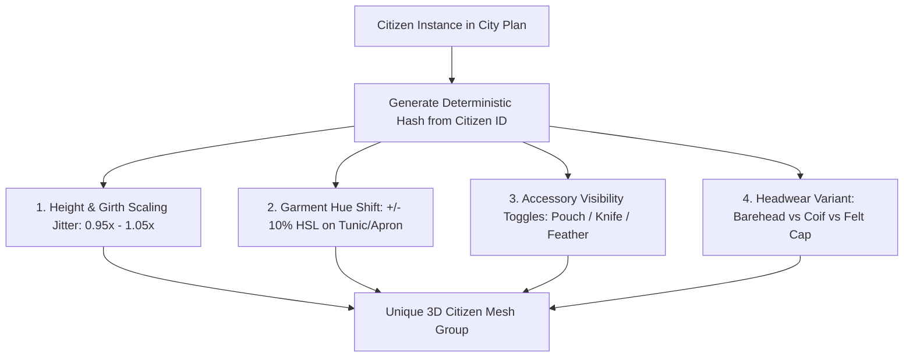

> **Superseded (2026-11-12).** This plan produced the legacy single-mesh characters. The current system is the kit pipeline: see `KEY_FINDINGS.md` §18 and `skills/blender-procedural-character-pipeline/SKILL.md`.

# Implementation Plan: Realistic & Differentiated Character System
## Lublin Anno Domini 1392 — Visual Character Architecture & 3D Asset Pipeline

> [!IMPORTANT]
> **Core Aesthetic Philosophy:** Faithful to late-1990s / early-2000s pre-rendered isometric PC strategy masterpieces (*Stronghold*, *Knights and Merchants*, *Patrician III*). Characters must exhibit crisp silhouettes, grounded historical 14th-century Central European costumes, profession-defining held tools, and distinct visual identities while remaining readable from high isometric camera vantage points.

---

## 1. Executive Summary & Design Goals

Currently, the 1,500 simulated citizens in the city are rendered in Three.js using simple geometric primitives (a basic cylinder torso, sphere head, and cone cap with rudimentary color coding). 

This plan establishes a complete, industrial-grade pipeline to transform these placeholders into **living, authentic medieval characters**, each with their own specialized look, costume, held tools, and animation behaviors:
1. **Unified 3-View Turnaround Reference Archive:** Generate side-by-side **Front, Side Profile, and Rear** orthographic character sheets for every major trade (carpenter, baker, tanner, blacksmith, brewer, potter, weaver, stonemason, monk, guard, merchant, farmer, etc.) adhering to the established art direction.
2. **Procedural 3D Character Authoring in Blender (`bpy` + `bmesh`):** Synthesize low-poly ($800 - 1,400$ triangles) GLTF/GLB character models featuring articulated hierarchies (Torso, Head, Headwear, Arms, Legs, Apron/Gear, Held Props) optimized for real-time WebGL.
3. **Anti-Cloning & Individual Variation Engine:** Ensure multiple workers of the same trade don't look like clones by introducing subtle procedural variance: height/girth scaling jitter, facial hair / hair toggles, garment tint shifts, and accessory variations.
4. **Real-time WebGL Performance Architecture:** Support all 1,500 active simulated citizens without frame drops using viewport frustum culling, distance-based LOD (full 3D models up close, instanced low-poly meshes at mid-range, 2.5D sprites in the background), and GPU instancing.
5. **Living Workstation Animations:** Implement looped craft activities (e.g., carpenter planing timbers, baker sliding bread peel into oven, tanner scraping stretched pelts) synchronized with outdoor workshop equipment.

---

## 2. Character Archetype Taxonomy & Visual Signatures

Every citizen archetype is designed with a specific visual silhouette, historical 14th-century attire, headgear, work apron, and held craft props:

```
+-------------------------------------------------------------------------------------------------------------------------+
|                                    MEDIEVAL CITIZEN ARCHETYPE ROSTER                                                    |
+----+-----------------------+-----------------------------+-----------------------+--------------------+-----------------+
| #  | Archetype ID          | Profession / Role           | Attire & Colors       | Headwear           | Held Tool / Prop|
+----+-----------------------+-----------------------------+-----------------------+--------------------+-----------------+
| 1  | `char_baker`          | Artisan Baker               | Flour-dusted apron    | White linen cap    | Wooden bread    |
|    |                       |                             | over bleached tunic   | (*barett*)         | peel shovel     |
+----+-----------------------+-----------------------------+-----------------------+--------------------+-----------------+
| 2  | `char_tanner`         | Master Tanner               | Water-resistant dark  | Tied linen coif    | Curved 2-handed |
|    |                       |                             | oiled rawhide apron   |                    | fleshing knife  |
+----+-----------------------+-----------------------------+-----------------------+--------------------+-----------------+
| 3  | `char_carpenter`      | Master Carpenter / Joiner   | Canvas work smock,    | Straw hat or       | Wood block plane|
|    |                       |                             | leather tool belt     | felt cap           | & broadaxe      |
+----+-----------------------+-----------------------------+-----------------------+--------------------+-----------------+
| 4  | `char_blacksmith`     | Master Blacksmith           | Heavy leather apron,  | White linen coif   | Cross-peen      |
|    |                       |                             | rolled linen sleeves  | tied under chin    | hammer & tongs  |
+----+-----------------------+-----------------------------+-----------------------+--------------------+-----------------+
| 5  | `char_brewer`         | Master Brewer / Cooper      | Stained leather apron,| Velvet chaperon    | Copper mash     |
|    |                       |                             | brick-red cotte       | or barehead        | paddle / adze   |
+----+-----------------------+-----------------------------+-----------------------+--------------------+-----------------+
| 6  | `char_potter`         | Master Potter               | Clay-spattered tunic, | Knotted headband   | Wooden shaping  |
|    |                       |                             | earthy ochre trousers |                    | rib & clay pot  |
+----+-----------------------+-----------------------------+-----------------------+--------------------+-----------------+
| 7  | `char_weaver`         | Master Weaver / Tailor      | Deep indigo/madder    | Burgundy wool hood | Threaded shuttle|
|    |                       |                             | burgher cotte         | with liripipe      | & shear scissors|
+----+-----------------------+-----------------------------+-----------------------+--------------------+-----------------+
| 8  | `char_stonemason`     | Stone Mason / Quarryman     | Rough linen smock,    | Felt cap or        | Iron chisel &   |
|    |                       |                             | heavy leather gloves  | barehead           | stone mallet    |
+----+-----------------------+-----------------------------+-----------------------+--------------------+-----------------+
| 9  | `char_woodcutter`     | Woodcutter / Pit Sawyer     | Dark woolen chausses, | Dark woolen hood   | Double-bit      |
|    |                       |                             | heavy forest smock    |                    | felling axe     |
+----+-----------------------+-----------------------------+-----------------------+--------------------+-----------------+
| 10 | `char_miller`         | Miller & Flour Porter       | Coarse flour-whitened | Burlap head-cowl   | Wooden grain    |
|    |                       |                             | smock & apron         |                    | scoop / sack    |
+----+-----------------------+-----------------------------+-----------------------+--------------------+-----------------+
| 11 | `char_friar`          | Dominican Friar / Cleric    | Undyed wool habit,    | Monastic cowl &    | Wooden hoe /    |
|    |                       |                             | dark brown scapular   | tonsure hair       | prayer psalter  |
+----+-----------------------+-----------------------------+-----------------------+--------------------+-----------------+
| 12 | `char_guard`          | Town Guard / Halberdier     | Quilted gambeson,     | Iron kettle hat /  | 2.2m Halberd /  |
|    |                       |                             | red city tabard       | sallet helmet      | steel crossbow  |
+----+-----------------------+-----------------------------+-----------------------+--------------------+-----------------+
| 13 | `char_merchant`       | Patrician & Burgher         | Fur-trimmed houppel-  | Padded chaperon    | Leather pouch & |
|    |                       |                             | ande, rich blue/green | with cockade       | wax seal scroll |
+----+-----------------------+-----------------------------+-----------------------+--------------------+-----------------+
| 14 | `char_farmer`         | Peasant Farmer              | Loose natural linen,  | Wide-brimmed       | Curved harvest  |
|    |                       |                             | rolled-up trousers    | woven straw hat    | steel scythe    |
+----+-----------------------+-----------------------------+-----------------------+--------------------+-----------------+
| 15 | `char_townswoman`     | Burgher Housewife / Trader  | Kirtle dress, white   | Crisp linen wimple | Wicker basket / |
|    |                       |                             | linen front apron     | or folded veil     | clay water jug  |
+----+-----------------------+-----------------------------+-----------------------+--------------------+-----------------+
```

---

## 3. Phase 1: Orthographic 3-View Turnaround Reference Pipeline

### The 3-View Single-Sheet Standard
To avoid AI hallucination and outfit drift across camera angles, each character archetype is generated on a **single unified 16:9 canvas** containing:
- **Front View:** Full silhouette, face/beard expression, chest attire, apron bib, belt fixtures, footwear.
- **Side Profile View:** Slouch/posture, apron strap harness, tool grip angle, hat brim depth.
- **Rear View:** Hood/chaperon drape, apron ties, rear belt pouch, tool scabbard, boot heels.

```
+-----------------------------------------------------------------------------------------+
|                                16:9 TURNAROUND CANVAS                                   |
|  +-----------------------+  +-----------------------+  +-----------------------+        |
|  |                       |  |                       |  |                       |        |
|  |      FRONT VIEW       |  |     PROFILE VIEW      |  |       REAR VIEW       |        |
|  |                       |  |                       |  |                       |        |
|  |  (Face, Apron Bib,    |  |  (Posture, Tool Angle,|  |  (Hood Drape, Straps, |        |
|  |   Held Tool, Belt)    |  |   Hat Depth, Boots)   |  |   Rear Pouch, Turn)   |        |
|  |                       |  |                       |  |                       |        |
|  +-----------------------+  +-----------------------+  +-----------------------+        |
|           Neutral Beige Parchment Background | Studio Directional Lighting               |
+-----------------------------------------------------------------------------------------+
```

### Prompt Engineering Template
```text
Orthographic 3-view character model sheet showing front view, side profile view, and rear view side-by-side,
14th-century medieval [CHARACTER ARCHETYPE / TRADE],
[PRIMARY COSTUME: tunic, chausses, materials, historical tailoring],
[SPECIALIZED WORK GEAR: apron, straps, belts, pouches, gloves],
[DISTINCT HEADWEAR: coif, chaperon, hat, cowl, or helmet],
holding [CHARACTERISTIC CRAFT TOOL / WEAPON],
neutral solid beige parchment background, crisp silhouette, studio lighting,
late 1990s PC strategy game sprite reference, no modern elements, no UI
```

### Target Delivery Files
All reference sheets will be generated and saved to `reference_photos/workers/`:
- `reference_photos/workers/worker_carpenter_turnaround.jpg` (New)
- `reference_photos/workers/worker_brewer_turnaround.jpg` (New)
- `reference_photos/workers/worker_potter_turnaround.jpg` (New)
- `reference_photos/workers/worker_weaver_turnaround.jpg` (New)
- `reference_photos/workers/worker_stonemason_turnaround.jpg` (New)
- `reference_photos/workers/worker_woodcutter_turnaround.jpg` (New)
- `reference_photos/workers/worker_miller_turnaround.jpg` (New)
- `reference_photos/workers/worker_monk_turnaround.jpg` (New)
- `reference_photos/workers/worker_guard_turnaround.jpg` (New)
- `reference_photos/workers/worker_patrician_turnaround.jpg` (New)
- `reference_photos/workers/worker_farmer_turnaround.jpg` (New)
- `reference_photos/workers/worker_townswoman_turnaround.jpg` (New)
*(Existing baker, tanner, and blacksmith turnarounds are already verified and stored)*.

---

## 4. Phase 2: Procedural 3D Modeling Architecture in Headless Blender

### Character Geometric Specification & Coordinate Frame
- **Scale:** $1.75\text{m}$ overall height (in Blender Z-up: $Z \in [0.0\text{m}, 1.75\text{m}]$).
- **Proportions:** Authentic late-1990s strategy game ratio ($1:6.5$ head-to-body), ensuring facial features and headwear remain visible at typical RTS zoom levels.
- **Polygon Budget:** $800$ to $1,400$ triangles per character model.

```
  Z (Height)
  1.75m +-- Headwear / Cap / Chaperon / Helm
  1.50m +-- Head & Face (Beard, Hair, Eyes)
  1.40m +-- Neck & Linen Collar / Hood Scarf
  0.90m +-- Torso, Woolen Tunic & Work Apron
        |   Left Arm (Offhand) / Right Arm (Dominant Tool Hand)
  0.80m +-- Leather Belt, Pouch, Scabbard
  0.15m +-- Chausses / Woolen Hose / Trousers
  0.00m +-- Sturdy Leather Turnshoes / High Work Boots
```

### Modular Bmesh Authoring (`build_characters.py`)
Rather than rigid monolithic meshes, characters will be generated modularly using reusable `bmesh` primitive builders:

```python
# Procedural limb & anatomical generators
def add_humanoid_torso(bm, cx, cy, cz, width=0.46, depth=0.28, height=0.60, mat_tunic=0, mat_apron=None): ...
def add_humanoid_head(bm, cx, cy, cz, head_radius=0.15, mat_skin=0, hair_style="coif", mat_hair=1): ...
def add_humanoid_headwear(bm, cx, cy, cz, style="linen_cap", mat_hat=0): ...
def add_humanoid_limbs(bm, cx, cy, cz, leg_height=0.75, arm_pose="working", mat_hose=0, mat_shoes=1): ...
def add_craft_tool_prop(bm, tool_type="bread_peel", hand_pos=(0.35, 0.15, 0.85), mat_wood=0, mat_iron=1): ...
```

### Texture Atlas & Material Shading
All characters bind to the master texture atlas slot `[1, 3]` (`Worker Costumes, Aprons & Leather`) or use PBR material vertex coloring with:
- `mat_skin_tone` (`#ECC39F` warm peach/tan skin)
- `mat_leather_heavy` (`#2A1E14` dark oiled leather)
- `mat_linen_flour` (`#ECE9E2` bleached/flour linen)
- `mat_wool_peasant` (`#7A6A53` rustic wool)
- `mat_wool_burgundy` (`#8C3B2B` dyed burgher cloth)
- `mat_iron_tool` (`#424246` wrought iron with metallic 0.7)
- `mat_wood_tool` (`#6B5238` polished ash/oak tool shafts)

### Export Target
Models export via Blender's glTF 2.0 exporter (`export_yup=True`) into:
`public/models/characters/char_[archetype].glb`

---

## 5. Phase 3: Anti-Cloning & Individual Variation Engine

To prevent the "attack of the clones" effect when 10 bakers or 30 guards walk the streets, the engine applies real-time micro-variations per individual `Citizen`:



1. **Deterministic Pseudo-Random Seed:** `hash(citizen.id)` determines exact variations so a citizen looks consistent across game days and reloads.
2. **Proportional Jitter:** Modest $\pm 5\%$ scaling on height ($1.68\text{m} - 1.84\text{m}$) and $\pm 7\%$ on shoulder girth.
3. **Palette Modulation:** Slight HSL shift on non-guild garments (e.g., peasants get varying beige/brown/russet tunics, guards get subtle weathering differences).
4. **Accessory Toggles:** Sub-meshes (quiver, hip knife, herb pouch, rolled sleeves) toggled dynamically based on citizen traits.

---

## 6. Phase 4: Engine Integration & Performance Architecture (Three.js)

### Two-Tier Citizen Dispatch Matrix
In `src/engine/three-renderer.ts`, the generic cylinder creation logic will be replaced with dynamic model loading and archetype caching:

```ts
const ARCHETYPE_MAP: Record<string, string> = {
  'Baker': 'char_baker',
  'Tanner': 'char_tanner',
  'Carpenter': 'char_carpenter',
  'Master Joiner & Cartwright': 'char_carpenter',
  'Wheelwright': 'char_carpenter',
  'Blacksmith': 'char_blacksmith',
  'Armorer': 'char_blacksmith',
  'Brewer': 'char_brewer',
  'Cooper': 'char_brewer',
  'Potter': 'char_potter',
  'Weaver': 'char_weaver',
  'Tailor': 'char_weaver',
  'Stone Mason': 'char_stonemason',
  'Dominican Friar': 'char_friar',
  'Collegiate Vicar': 'char_friar',
  'Town Halberdier & Gate Watch': 'char_guard',
  'Hanseatic Merchant': 'char_merchant',
  'Amber & Salt Merchant': 'char_merchant',
  'Royal Factor': 'char_merchant',
  'Shoemaker': 'char_tanner',
  'Butcher': 'char_tanner',
};
```

### High-Scale WebGL Performance (1,500 Citizens)
Rendering 1,500 distinct animated 3D models concurrently could overwhelm WebGL draw-call budgets. We employ a 3-tier Level of Detail (LOD) system:

```
+-----------------------------------------------------------------------------------------+
|                                THREE-TIER CITIZEN LOD SYSTEM                            |
+-------------------+----------------------------+----------------------------------------+
| Distance / State  | Rendering Technique        | Triangle & Draw Call Budget            |
+-------------------+----------------------------+----------------------------------------+
| 0m - 40m          | Full 3D Archetype Model    | ~1,000 tris per model, shadow casters, |
| (Near Camera View)| with Individual Jitter     | articulated walking & tool animations  |
+-------------------+----------------------------+----------------------------------------+
| 40m - 100m        | Instanced Mesh Batch       | 1 draw call per archetype via          |
| (Mid-Range View)  | (LOD Simplified)           | THREE.InstancedMesh, matrix transforms |
+-------------------+----------------------------+----------------------------------------+
| > 100m or Out-of- | 2.5D Animated Sprite Quad  | Batched multi-texture sprite renderer  |
| Frustum           | or Culled from 3D Scene    | zero CPU matrix overhead               |
+-------------------+----------------------------+----------------------------------------+
```

### Articulated Walking & Looped Workstation Animations
- **Walk Bob & Foot Strike:** Sinusoidal hip translation and alternating arm swing synced to velocity ($v \approx 1.2\text{m/s}$).
- **Stationary Craft Animation:** When `citizen.state === 'working'` at their assigned building parcel, play the archetype's signature loop (baker feeding the oven, carpenter sawing timber, smith hammering anvil, friar tending herbs).

---

## 7. Phased Execution Roadmap


### Phase 1: Reference Turnaround Sheet Generation
- Author and generate 3-view turnaround references (`front`, `side`, `rear`) for all missing trades using the `generate_image` tool:
  - `worker_carpenter_turnaround.jpg`
  - `worker_brewer_turnaround.jpg`
  - `worker_potter_turnaround.jpg`
  - `worker_weaver_turnaround.jpg`
  - `worker_stonemason_turnaround.jpg`
  - `worker_monk_turnaround.jpg`
  - `worker_guard_turnaround.jpg`
  - `worker_merchant_turnaround.jpg`
  - `worker_farmer_turnaround.jpg`
  - `worker_townswoman_turnaround.jpg`
- Save to `reference_photos/workers/`.

### Phase 2: Procedural 3D Character Pipeline (`build_characters.py`)
- Create dedicated headless script `build_characters.py` using Blender 3.6 LTS.
- Author procedural bmesh recipes for body, heads, costumes, aprons, and tool props.
- Export clean, low-poly `.glb` models into `public/models/characters/*.glb`.
- Validate models (polycounts, bounding boxes, outward normals, ground origins).

### Phase 3: Catalog & Documentation Updates
- Update `BUILDINGS_AND_WORKERS_CATALOG.md` and `buildings_and_workers_catalog.json` with new character models and prop coordinates.
- Update `docs/IMAGE_GENERATION_PROMPTS_AND_GALLERY.md` with high-resolution image embeds, prompts, and turnaround breakdown.

### Phase 4: Three.js Engine Integration & Individualization
- Update `src/engine/three-renderer.ts` to asynchronously load character models.
- Implement trade archetype mapping and deterministic procedural jitter.
- Implement viewport frustum culling and LOD instancing for 1,500 citizens.
- Hook up walk cycles and outdoor workstation task animations.

### Phase 5: Verification & Quality Audits
- Verify character rendering in headless Chromium / Vite build.
- Capture high-resolution screenshots of craftspeople at their workshops (baker at oven, carpenter at timber yard, tanner at river vats, guards at gates).
- Confirm 60 FPS performance and zero WebGL errors.

---

## 8. Summary of Deliverables

| Deliverable | Location | Description |
|---|---|---|
| **Turnaround Reference Sheets** | `reference_photos/workers/*_turnaround.jpg` | 12+ orthographic 3-view character model sheets |
| **Blender Asset Script** | `build_characters.py` | Headless procedural geometry authoring script |
| **Compiled 3D Character Models** | `public/models/characters/*.glb` | Optimized low-poly WebGL models for each trade |
| **Three.js Engine Integration** | `src/engine/three-renderer.ts` | Archetype dispatch, individualization, animations |
| **Catalog & Documentation** | `BUILDINGS_AND_WORKERS_CATALOG.md`, `IMAGE_GENERATION_PROMPTS_AND_GALLERY.md` | Master specification & visual reference gallery |
